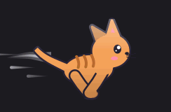
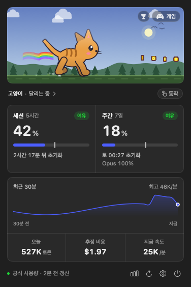
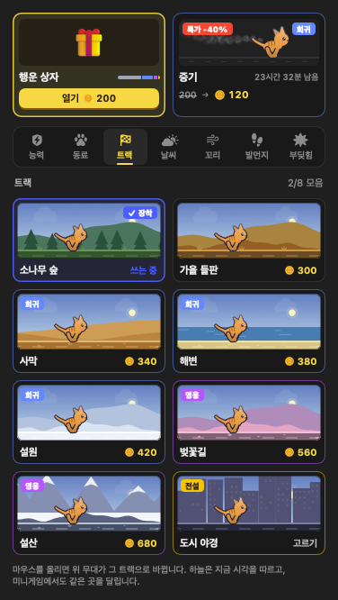
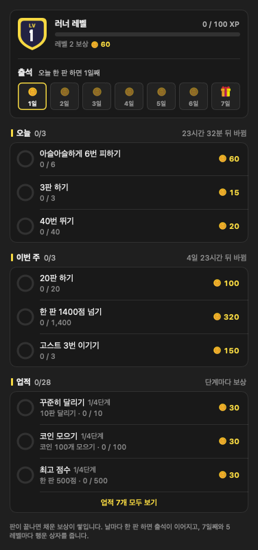
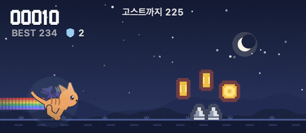
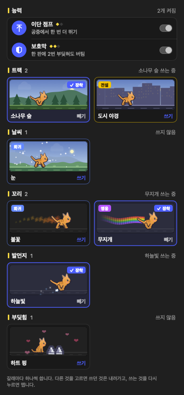

# RunTime

<p align="center">
  
</p>

Claude Code를 쓰는 만큼 macOS 메뉴바의 러너가 빨리 달립니다.
러너를 누르면 5시간 세션과 주간 사용률이 나와서, `/usage`를 치지 않아도 한도가 얼마나 남았는지 알 수 있습니다.

<p align="center">
  
  
  
</p>

- 사용률은 Claude가 알려 주는 공식 값이라 웹과 데스크톱 앱에서 쓴 양도 들어갑니다.
- 80%, 95%에 닿으면 러너가 지치고 알림이 옵니다.
- 러너 28종, 내 그림, [Petdex](https://petdex.dev) 펫 가운데 골라 달립니다.
- 무대에서 장애물 피하기 미니게임을 하고, 모은 코인으로 트랙·날씨·꼬리 같은 꾸미기를 삽니다.
- Claude Code가 대답을 마치면 러너가 알려 줍니다.

Anthropic이 만든 앱이 아닌 개인 프로젝트입니다.

## 설치

macOS 13 이상, Claude Code에 로그인한 상태, Swift 툴체인이 필요합니다.
Swift가 없으면 먼저 `xcode-select --install`을 실행하세요.

```bash
git clone https://github.com/youminki/RunTime.git
cd RunTime
./install.sh
```

내 Mac에서 직접 빌드해 응용 프로그램 폴더에 넣고 바로 실행합니다. 빌드는 1~2분 걸립니다.
직접 빌드한 앱이라 "확인되지 않은 개발자" 경고는 뜨지 않습니다.

처음 한 번은 아래 창이 뜹니다.

| 창 | 누를 것 | 이유 |
| --- | --- | --- |
| 서명 인증서를 신뢰할지 묻는 로그인 암호 | 암호 입력 | 앱을 다시 빌드해도 키체인 허용이 풀리지 않게 서명용 인증서를 한 번 만듭니다 |
| "security가 키체인에 접근하려고 합니다" | **항상 허용** | Claude Code의 로그인 토큰으로 사용량을 조회합니다. "허용"만 누르면 다음에 또 묻습니다 |
| 알림 허용 | 허용 | 80%, 95% 알림에 씁니다 |

클론한 폴더는 지우지 마세요. 앱 안에서 업데이트할 때 이 폴더에서 다시 빌드합니다.

## 쓰는 법

| 하고 싶은 것 | 방법 |
| --- | --- |
| 사용량 보기 | 메뉴바 러너를 누르거나 ⌃⌥U |
| 일별 사용량, 순위, 설정 | 러너를 오른쪽 클릭 |
| 러너 바꾸기 | 사용량 창에서 러너 이름(`고양이 ›`)을 누르고 러너 탭 |
| 미니게임 | 무대 오른쪽 위 "게임". 스페이스·클릭으로 점프(길게 누르면 높이), ↓로 숙이기 |
| 꾸미기 사기·쓰기 | 러너 이름을 누르고 상점·창고 탭 |

러너는 최근 1분 동안 쓴 토큰 양에 맞춰 걷고, 달리고, 질주합니다. 5분 넘게 쓰지 않으면 잡니다.

<p align="center">
  
</p>

<p align="center">
  
</p>

화면마다 자세한 설명은 [자세한 사용법](docs/guide.md)에 있습니다.

## 업데이트

앱이 30분마다 GitHub에서 새 버전을 확인하고, 있으면 러너가 말풍선으로 알려 줍니다.
설정 > 일반 > 업데이트에서 "업데이트"를 누르거나 "자동으로 업데이트"를 켜 두면, 클론한 폴더에서 새 코드를 받아 다시 빌드합니다.
1~2분 동안 러너가 사라졌다가 새 버전으로 나타납니다. 빌드가 실패하면 쓰던 앱이 그대로 남고, 로그는 `~/Library/Logs/RunTime/update.log`에 있습니다.

터미널에서 하려면 클론한 폴더에서 `git pull --ff-only && ./install.sh`를 실행하세요. 달라진 점은 [변경 기록](CHANGELOG.md)에 있습니다.

## 지우기

응용 프로그램 폴더에서 `RunTime.app`을 지웁니다. 설정과 기록까지 지우려면 아래도 실행하세요.

```bash
defaults delete dev.runtime.RunTime
rm -rf ~/Library/Application\ Support/RunTime ~/Library/Logs/RunTime
```

## 자주 묻는 것

**키체인 암호를 계속 물어요.**
창이 뜰 때 "허용" 대신 "항상 허용"을 누르세요. `~/.claude/.credentials.json` 파일이 있으면 키체인보다 그 파일을 먼저 읽어서 창이 뜨지 않습니다.

**메뉴바에서 러너가 안 보여요.**
화면이 좁고 앞에 있는 앱의 메뉴가 길면 macOS가 메뉴바 항목을 왼쪽부터 « 안으로 숨깁니다.
install.sh는 처음 설치할 때 러너를 오른쪽 끝에 두어 가장 늦게 숨게 합니다. 그래도 숨으면 ⌘를 누른 채
러너를 « 단추 오른쪽으로 끌어 두세요. macOS가 그 자리를 기억하고, 업데이트해도 옮기지 않습니다.

**`/usage`와 숫자가 달라요.**
공식 값은 3분마다 받아서 최대 3분까지 늦을 수 있습니다. 사용량 창을 열거나 ↻를 누르면 바로 다시 받습니다.

**예전 이름 TokenCat으로 설치했어요.**
업데이트하거나 `./install.sh`를 다시 실행하면 옛 앱을 지우고 `RunTime.app`을 설치합니다.
설정, 최고 점수, 순위 참여 정보, 내 러너와 받은 펫, 로그인 시 자동 시작은 새 앱이 처음 켜질 때 옮겨 옵니다.
알림 허용은 한 번 더 묻습니다. 옛 설정(`dev.tokencat.TokenCat`)은 지우지 않으니 필요 없으면
`defaults delete dev.tokencat.TokenCat`로 지우세요.

## 무엇을 어디로 보내나

| 보내는 곳 | 언제 | 보내는 것 |
| --- | --- | --- |
| Anthropic | 3분마다 | Claude Code 로그인 토큰으로 사용률 조회 |
| 순위 서버 | 순위에 참여했을 때 | 무작위 설치 ID, 닉네임, 그리고 최근 7일 기록을 넘은 판의 점수, 코인 수, 플레이 시간, 앱 버전 |
| 순위 서버 | 순위에 참여해 최고 기록을 올렸을 때 | 그 판의 고스트 (씨앗, 키 입력 기록, 러너 이름). 내 그림 러너는 이름을 보내지 않음 |
| 순위 서버 | 사용량 창이나 순위표 창이 열려 있을 때 30초마다, 참여 중이면 10분마다 | 참여 전에는 없음 (공개 순위만 받음). 참여 중에는 내 순위를 알려고 설치 ID를 함께 보냄 |
| petdex.dev | Petdex에서 찾기를 열었을 때 | 없음 (펫 목록과 그림만 받음) |
| GitHub | 30분마다 | 없음 (공개 저장소의 커밋 비교만 받음) |

로그인 토큰은 읽기만 하고, Anthropic 말고는 어디에도 보내지 않으며 디스크나 로그에 남기지 않습니다.
키체인을 자동으로 열거나 암호를 저장하지도 않습니다.

## 한계

- 사용률은 Anthropic이 공식으로 안내하지 않은 방식으로 받습니다. 이 방식이 바뀌거나 막히면 사용률은 `--`로 비고 속도와 오늘 사용량만 보입니다.
- 키체인은 Apple의 `/usr/bin/security`로 읽습니다. 그래서 다시 빌드해도 다시 묻지 않지만,
  "항상 허용"을 누른 뒤에는 다른 프로그램도 같은 방법으로 이 토큰을 읽을 수 있습니다.
- Agent SDK나 `claude -p`로 쓴 양은 한도가 따로라서 기록에 SDK 표시가 있으면 따로 보여 줍니다. 표시가 확실하지 않아 추정입니다.
- 움직임이 많은 Petdex 펫은 메뉴바 칸(30px 안팎)에서 뭉개져 보일 수 있습니다.

## 개발

```bash
swift run RunTime             # 빌드하지 않은 채 개발 실행 (알림과 자동 시작은 동작하지 않음)
./scripts/test.sh             # 테스트
scripts/build-app.sh          # dist/RunTime.app과 dmg 만들기
python3 -I scripts/update-prices.py   # Claude 모델 단가를 LiteLLM 가격 데이터에서 다시 받아 PricingData.swift 만들기
python3 -I scripts/update-aliases.py  # Petdex 캐릭터의 한국어 이름을 Wikidata에서 받아 한글 검색 사전 만들기 (30분쯤)
```

설계 결정, 측정값, 트러블슈팅 기록은 [개발 기록](docs/development.md)에 모았습니다.

<details>
<summary>점검용 실행 옵션과 순위 서버</summary>

`.build/debug/RunTime` 뒤에 붙여 실행합니다.

| 옵션 | 하는 일 |
| --- | --- |
| `--report` | 집계를 ccusage와 비교 |
| `--sprite-sheet <폴더>` | 모든 러너의 동작을 시트로 저장 |
| `--menubar-audit <폴더> [화면 배율] [메뉴바 높이] [크기 배율]` | 메뉴바 칸에서 잘림, 키, 어두운 윤곽을 `report.tsv`와 시트로 저장 |
| `--stage-shots <폴더> [러너 id] [트랙·날씨,...]` | 상태와 사용량 반응마다 무대 장면과 메뉴바 프레임을 PNG로 저장 |
| `--game-shots <폴더> [러너 id]` | 미니게임을 자동으로 플레이하며 장면을 PNG로 저장 |
| `--game-frames <폴더>` | README 게임 GIF용 장면을 이어 찍기 (`scripts/make-game-gif.sh`가 GIF로 만듦) |
| `--game-bench` | 무대와 게임 한 장면을 그리는 데 드는 시간 재기 (`BENCH_FRAMES`로 장면 수) |
| `--hero-gif <파일>` | README 맨 위 GIF 만들기 |
| `--ui-shots <폴더>` | 팝오버, 설정 구역, 일별 사용량, 순위표를 실제 데이터로 찍어 PNG로 저장 |
| `--readme-shots <폴더>` | README 그림을 예시 값으로 찍기 (내 사용량과 지갑은 쓰지 않음) |
| `--game-sim [판 수] [목표 점수]` | 미니게임을 화면 없이 여러 판 돌려 초반 타이밍 창과 실력별 도달 점수 재기 |

진단 로그는 `log stream --predicate 'subsystem == "dev.runtime.RunTime"' --level debug`로 봅니다.

순위 서버는 `server/leaderboard/`에 있습니다(Cloudflare Workers + D1).

```bash
cd server/leaderboard
npm test                 # 규칙 테스트
npm run dev              # 로컬 서버를 띄운 뒤, 다른 터미널에서
node test/e2e.mjs        # 통합 테스트
npx wrangler@4 login && ./deploy.sh
```

</details>

## 출처와 라이선스

- 메뉴바 러너는 [RunCat](https://kyome.io/runcat/)에서, 미니게임의 무지개 꼬리는 냥캣에서 아이디어를 얻었습니다. 러너 그림은 모두 직접 그렸습니다.
- 미니게임의 장애물 간격과 속도 규칙은 [Chromium T-Rex Runner](https://chromium.googlesource.com/chromium/src/+/main/components/neterror/resources/)(BSD 3-Clause)를 따랐습니다.
- 미니게임 그림과 효과음은 Kenney의 [Pixel Platformer](https://kenney.nl/assets/pixel-platformer), [Digital Audio](https://kenney.nl/assets/digital-audio), [Music Jingles](https://kenney.nl/assets/music-jingles), [Interface Sounds](https://kenney.nl/assets/interface-sounds)(CC0)입니다.
- 미니게임 글자는 [Galmuri](https://github.com/quiple/galmuri)(SIL OFL 1.1) 픽셀 글꼴입니다. 한글·영문·기호만 남겨 싣습니다.
- 집계 규칙은 [ccusage](https://ccusage.com/guide/blocks-reports)를 참고했습니다.
- 비용 계산 단가는 ccusage와 같은 [LiteLLM 가격 데이터](https://github.com/BerriAI/litellm/blob/main/model_prices_and_context_window.json)(MIT)에서 가져옵니다.

MIT 라이선스입니다. Anthropic, Claude와 관계없는 비공식 도구입니다.
