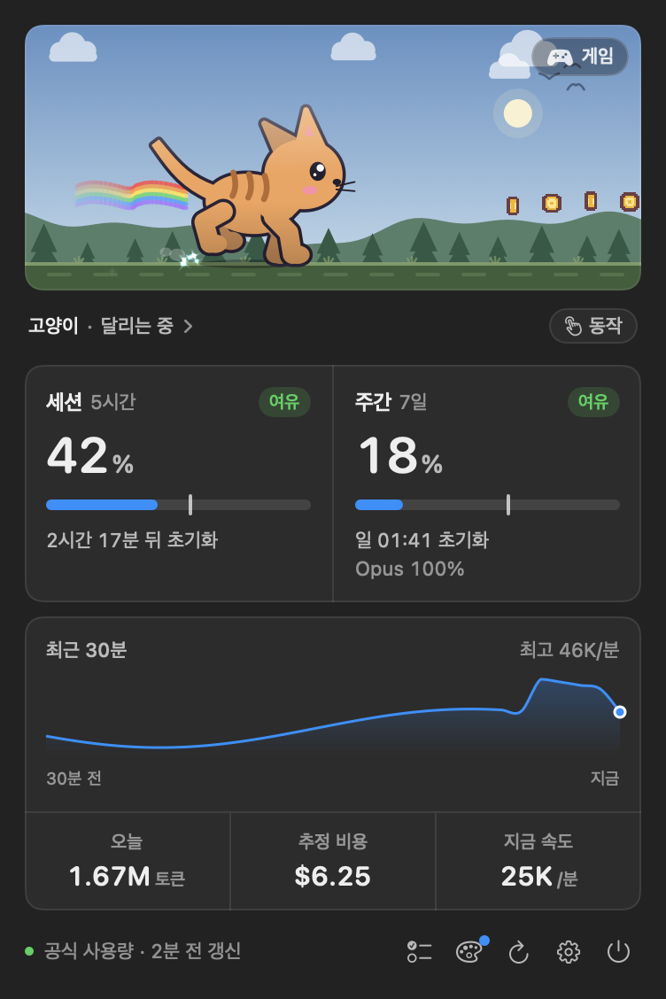
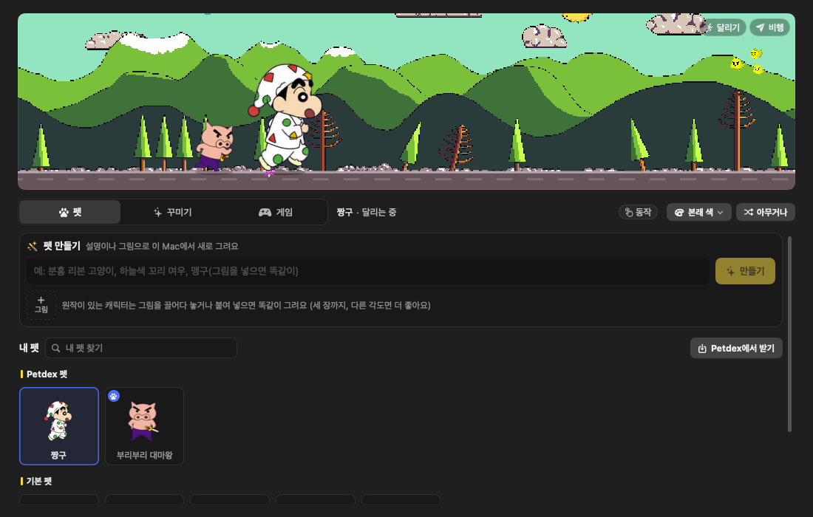
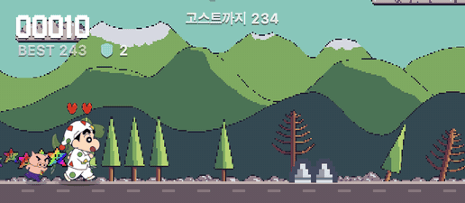
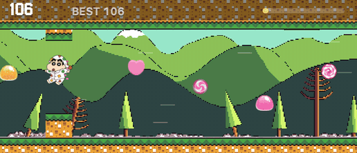

# RunTime

<p align="center">
  
</p>

Claude Code를 쓰는 만큼 macOS 메뉴바의 펫이 빨리 달립니다.
펫을 누르면 5시간 세션과 주간 사용률이 나와서, `/usage`를 치지 않아도 한도가 얼마나 남았는지 알 수 있습니다.
펫은 Petdex에서 5천여 종 가운데 고르거나, 설명 한 줄로 이 Mac에서 직접 만들 수 있습니다.

<p align="center">
  
  
</p>

Anthropic이 만든 앱이 아닌 개인 프로젝트입니다.

## 할 수 있는 것

| | |
| --- | --- |
| 사용량 | Claude가 알려 주는 공식 세션·주간 사용률(웹과 데스크톱 앱에서 쓴 양 포함), 최근 30분 그래프, 날짜별 사용량. 80%, 95%에 닿으면 펫이 지치고 알림이 옵니다 |
| 펫 | 기본 펫 5종, [Petdex](https://petdex.dev) 펫 5천여 종(이름은 한국어로), 내 GIF·PNG 그림. 펫마다 손 흔들기, 점프, 생각, 시무룩 같은 동작으로 상태를 보입니다 |
| 펫 만들기 | 설명이나 그림을 넣고 누르면 이 Mac에서 Petdex와 같은 품질의 펫을 그려 바로 달리게 합니다. 무료이고, 마음에 안 들면 고칠 점을 적어 고치고, Petdex에 올려 다른 사람과 나눌 수 있습니다 |
| 게임 | 무대에서 하는 미니게임 두 가지. 달리기(장애물 넘기)와 비행(누르는 동안 오르기), 각각 쉬움·보통·어려움 |
| 꾸미기 | 도트 배경 59종, 꼬리, 발먼지, 부딪힘 효과, 함께 달리는 동료 펫 |
| 알림 | Claude Code가 대답을 마치면 펫이 알려 줍니다 |
| 일 도구 | 업무 일지와 일일·주간 보고, 레드마인, 피그마 화면설계서 변경 기록, /etc/hosts 관리, Claude 계정 바꾸기 |

## 설치

macOS 13 이상, Claude Code에 로그인한 상태, Swift 6.0 이상(Xcode 16 또는 Command Line Tools 16 이상)이 필요합니다.
Swift가 없으면 먼저 `xcode-select --install`을 실행하세요.

```bash
git clone https://github.com/youminki/RunTime.git
cd RunTime
./install.sh
```

내 Mac에서 직접 빌드해 응용 프로그램 폴더에 넣고 바로 실행합니다. 빌드는 1~2분 걸리고, 직접 빌드한 앱이라 "확인되지 않은 개발자" 경고는 뜨지 않습니다.
Xcode와 Command Line Tools가 함께 있으면 Swift가 더 새것인 쪽으로 빌드하고, 너무 오래됐거나 Xcode 약관에 동의하지 않았으면 무엇을 하면 되는지 알려 주고 멈춥니다.

처음 한 번은 아래 창이 뜹니다.

| 창 | 누를 것 | 이유 |
| --- | --- | --- |
| 서명 인증서를 신뢰할지 묻는 로그인 암호 | 암호 입력 | 앱을 다시 빌드해도 키체인 허용이 풀리지 않게 서명용 인증서를 한 번 만듭니다 |
| "security가 키체인에 접근하려고 합니다" | **항상 허용** | Claude Code의 로그인 토큰으로 사용량을 조회합니다. "허용"만 누르면 다음에 또 묻습니다 |
| 알림 허용 | 허용 | 80%, 95% 알림에 씁니다 |

클론한 폴더는 지우지 마세요. 앱 안에서 업데이트할 때 이 폴더에서 다시 빌드합니다.

## 쓰는 법

| 하고 싶은 것 | 방법 |
| --- | --- |
| 사용량 보기 | 메뉴바 펫을 누르거나 ⌃⌥U |
| 앱 창 열기 (날짜별 사용량, 펫, 게임, 설정) | 펫을 오른쪽 클릭, 또는 사용량 창 아래 "앱 창에서 열기" |
| 펫 바꾸기 | 사용량 창에서 펫 이름(`짱구 ›`)을 누르거나, 앱 창 왼쪽 "러너"의 펫 탭 |
| 펫 만들기 | 펫 탭 맨 위 "펫 만들기" 카드. 자세한 방법은 아래 [펫 만들기](#펫-만들기) |
| Petdex에서 펫 받기 | 펫 탭 "내 펫" 오른쪽 "Petdex에서 받기" |
| 같이 달릴 동료 정하기 | 꾸미기 탭의 "같이 달리는 동료", 또는 펫을 오른쪽 클릭하고 "동료로 데려가기" |
| 배경·꼬리·발먼지 바꾸기 | 러너 화면의 꾸미기 탭. 마우스를 올리면 무대에서 미리 봅니다 |
| 게임 | 무대 오른쪽 위 "달리기" 또는 "비행"을 누르고 난이도 고르기 (1·2·3, return은 지난번 난이도) |
| 펫 움직이기 | 무대에서 ←→ 걷기, 스페이스 점프, 펫을 끌어 옮기기, 빈 땅을 누르면 그리로 걸어감 |
| 펫을 화면에 꺼내기 | 러너 화면 위 "화면에 펫 꺼내기", 또는 메뉴바 펫을 오른쪽 클릭하고 "펫 꺼내기". 화면 가장자리를 돌아다니고, 끌어다 놓으면 그 자리에 머뭅니다(다른 모니터로도). 펫을 오른쪽 클릭하면 크기, 움직이는 방식, 앱 화면 바로 가기가 있습니다 |
| 업무 일지, 보고서 복사 | 펫을 오른쪽 클릭하고 "업무 일지" |
| 레드마인 일감 보기·고치기 | 앱 창 왼쪽 "레드마인"(⌘4) |
| 피그마 화면설계서에서 바뀐 화면 보기 | 앱 창 왼쪽 "디자인"(⌘5) |
| /etc/hosts 켜고 끄기 | 앱 창 왼쪽 "호스트"(⌘6), 또는 펫을 오른쪽 클릭하고 "호스트" |
| Claude 계정 바꾸기 | 펫을 오른쪽 클릭하고 "Claude 계정". 다른 계정은 Claude Code에서 `/login` 하면 저절로 추가됩니다 |

펫은 최근 1분 동안 쓴 토큰 양에 맞춰 걷고, 달리고, 질주합니다. 5분 넘게 쓰지 않으면 잡니다.
화면마다 자세한 설명은 [자세한 사용법](docs/guide.md)에 있습니다.

## 펫 만들기

펫 탭 왼쪽 "펫 만들기" 칸에서 합니다. 예시를 누르면 설명 칸이 채워집니다.

1. 만들 펫을 적습니다. `분홍 리본 고양이`, `하늘색 꼬리 여우`처럼 생김새를 적어도 되고, `훈이`, `철수`처럼 캐릭터 이름을 적어도 됩니다.
2. 원작이 있는 캐릭터를 똑같이 만들고 싶으면 그림을 카드에 끌어다 놓거나 붙여 넣습니다(세 장까지). 그림을 넣지 않으면 Claude가 웹에서 그 캐릭터 그림을 찾아 맞는지 확인한 뒤 따라 그립니다.
3. "만들기"를 누릅니다. 6~8분 동안 기본 모습, 옆모습, 동작이 차례로 그려지는 모습과 남은 시간이 보이고, 다른 일을 해도 됩니다. 다 되면 바로 그 펫이 달립니다.
4. 마음에 안 들면 "고칠 점"에 `빨간 모자를 씌워 줘`, `눈을 더 크게`처럼 적고 "고치기"를 누릅니다. 그 부분만 바꿔 다시 그리고 지금 펫과 바꿉니다. 처음부터 다시 그리려면 "다시 그리기"를 누릅니다.
5. 다른 사람도 쓰게 하려면 "Petdex에 올리기"를 누릅니다. 처음 한 번 브라우저에서 Petdex에 로그인하면 바로 올라가고, 심사가 끝나면 이메일로 알려 줍니다. 하루 10개까지 올릴 수 있습니다.

알아 두면 좋은 것:

- 그림은 이 Mac에서 FLUX.2 klein 4B(무료, Apache 2.0)로 그립니다. 처음 한 번 그림 도구와 모델 약 5GB를 받고, "펫 만들기" 칸 아래 "펫 만들기 모델 지우기"로 지울 수 있습니다(만든 펫은 남습니다).
- 파이썬 3.10 이상이 필요합니다. macOS에 딸린 파이썬은 3.9라, 없으면 `brew install python`으로 깔아 주세요.
- 그리는 동안 메모리를 많이 써서 16GB Mac에서 무거운 앱과 같이 돌리면 느려질 수 있습니다.
- 이름과 생김새 정리, 웹에서 그림 찾기, 옆모습 고르기, 다 그린 뒤 칸마다 같은 캐릭터인지 검수하기에 이 Mac의 Claude Code를 씁니다. 검수에서 다른 캐릭터로 바뀌었거나 몸이 잘린 칸은 이웃 칸으로 바꿉니다. Claude Code가 없으면 적은 설명만으로 그리고 검수는 건너뜁니다.
- 걷기는 메뉴바에서 늘 보이는 동작이라 두 장을 그려 다리가 더 크게 움직이는 쪽을 씁니다.

## 게임

<p align="center">
  
  
</p>

| | 달리기 | 비행 |
| --- | --- | --- |
| 하는 것 | 끝없이 달리며 장애물을 넘어 최고 점수 | 누르는 동안 올라가며 끝없이 날기 |
| 조작 | 스페이스·↑·클릭 점프(길게 누르면 높이), ↓ 숙이기, ←→ 이동, G 고스트와 겨루기 | 스페이스·↑·클릭을 누르는 동안 상승, →·오른쪽 클릭 가속(점수 더) |
| 난이도 | 쉬움·보통·어려움, 갈수록 빨라지고 장애물이 촘촘해짐 | 쉬움·보통·어려움, 멀리 갈수록 빨라지고 장애물 11가지가 무작위로 나옴 |
| 그 밖에 | 사탕 콤보: 놓치지 않고 이어 먹으면 10·20·30·40·50점 | 사탕, 보호막, 아슬아슬 보너스, 붙으면 무거워지는 슬라임 |

esc로 나갑니다. 앱 창에서는 무대 크기 그대로 게임을 하고, 어떤 판이든 반응만 빠르면 지나갈 수 있게 배치합니다.

## 업데이트

앱이 30분마다, 그리고 매일 오전 9시에 GitHub에서 새 버전을 확인합니다. 새 버전이 있으면 펫이 말풍선으로 알려 주고, 말풍선을 누르면 바로 업데이트합니다. 업데이트를 마치면 바뀐 점을 패치노트로 보여 줍니다.
설정 > 일반 > 업데이트에서 "자동으로 업데이트"를 켜 두면 묻지 않고 조용히 업데이트합니다. 1~2분 동안 펫이 사라졌다가 새 버전으로 나타납니다.
클론에서 다른 브랜치로 일하거나 커밋하지 않은 변경이 있으면, 그 폴더는 건드리지 않고 업데이트 전용 폴더(`~/Library/Application Support/RunTime/update-source`)에서 GitHub 최신을 빌드해 설치합니다. 빌드가 실패하면 쓰던 앱이 그대로 남고, 로그는 `~/Library/Logs/RunTime/update.log`에 있습니다.

터미널에서 하려면 클론한 폴더에서 `git pull --ff-only && ./install.sh`를 실행하세요. 달라진 점은 [변경 기록](CHANGELOG.md)에 있습니다.
버전은 `VERSION`의 주.부 번호에 그 뒤 쌓인 커밋 수를 붙여 커밋마다 오릅니다(예: 0.8.3).

## 지우기

응용 프로그램 폴더에서 `RunTime.app`을 지웁니다. 설정, 기록, 받은 펫, 펫 만들기 모델(약 5GB)까지 지우려면 아래도 실행하세요.

```bash
defaults delete dev.runtime.RunTime
rm -rf ~/Library/Application\ Support/RunTime ~/Library/Logs/RunTime
```

## 자주 묻는 것

**키체인 암호를 계속 물어요.**
창이 뜰 때 "허용" 대신 "항상 허용"을 누르세요. `~/.claude/.credentials.json` 파일이 있으면 키체인보다 그 파일을 먼저 읽어서 창이 뜨지 않습니다.

**메뉴바에서 펫이 안 보여요.**
화면이 좁고 앞에 있는 앱의 메뉴가 길면 macOS가 메뉴바 항목을 왼쪽부터 « 안으로 숨깁니다.
⌘를 누른 채 펫을 « 단추 오른쪽으로 끌어 두세요. macOS가 그 자리를 기억하고, 업데이트해도 옮기지 않습니다.

**`/usage`와 숫자가 달라요.**
공식 값은 3분마다 받아서 최대 3분까지 늦을 수 있습니다. 사용량 창을 열거나 ↻를 누르면 바로 다시 받습니다.

**만든 펫이 원작과 달라요.**
캐릭터 그림을 카드에 끌어다 놓고 다시 그려 보세요. 다른 각도의 그림을 더 넣으면 옆모습이 더 닮습니다. 조금만 다르면 "고칠 점"으로 고치는 편이 빠릅니다.

**Petdex에서 찾는 펫이 안 나와요.**
Petdex 창은 처음부터 "전체"에서 찾습니다. 한글, 영어, 원어 이름 모두 됩니다. 새로 올라온 펫은 1시간 안에 목록에 들어오고, 창의 ↻로 바로 받을 수도 있습니다.

**예전 이름 TokenCat으로 설치했어요.**
업데이트하거나 `./install.sh`를 다시 실행하면 옛 앱을 지우고 `RunTime.app`을 설치합니다. 설정, 최고 점수, 내 펫은 새 앱이 처음 켜질 때 옮겨 옵니다.
옛 설정(`dev.tokencat.TokenCat`)은 지우지 않으니 필요 없으면 `defaults delete dev.tokencat.TokenCat`로 지우세요.

## 무엇을 어디로 보내나

| 보내는 곳 | 언제 | 보내는 것 |
| --- | --- | --- |
| Anthropic | 3분마다 | Claude Code 로그인 토큰으로 사용률 조회 |
| Anthropic | Claude 계정이 둘 이상일 때 10분마다, 토큰이 바뀌었을 때 | 저장해 둔 다른 계정 토큰으로 사용률 조회, 토큰이 어느 계정 것인지 확인, 다른 계정 토큰이 만료되기 전에 리프레시 토큰으로 새로 받기 |
| Anthropic (내 Claude Code) | 업무 일지에서 "Claude로 다듬기"를 눌렀을 때, `--worklog polish` | 그날 진행 사항 글. 이 Mac의 `claude -p`를 내 로그인으로 부르고, 결과는 고쳐 쓸 수 있는 초안으로만 둠 |
| Anthropic (내 Claude Code) | 펫을 만들거나 고칠 때, Petdex 창을 열었을 때 | 펫 설명과 고칠 점, 웹에서 찾은 후보 그림, 옆모습 후보 그림, 공식 이름표에 없는 Petdex 펫 이름 (이름은 한 번 다듬으면 이 Mac에 저장해 다시 묻지 않음). 이 Mac의 `claude -p`를 내 로그인으로 부름 |
| 웹 검색으로 찾은 그림 주소 | 그림 없이 원작 캐릭터를 만들 때 | 없음 (그림 파일만 받아 맞는지 확인하고 지움) |
| huggingface.co, pypi.org | 펫 만들기를 처음 할 때 한 번 | 없음 (그림 모델 약 4.3GB와 그림 도구 약 0.5GB를 받음) |
| petdex.dev | Petdex에서 받기를 열었을 때, "Petdex에 올리기"를 눌렀을 때 | 받을 때는 없음 (펫 목록과 그림만 받음). 올릴 때는 그 펫의 `pet.json`과 시트를 내 Petdex 계정으로 올림 |
| 보고 서버 | 업데이트 설치가 실패하거나 멈췄을 때, 화면에서 일이 실패했을 때, 앱이 죽거나 5초 넘게 멈췄을 때 (설정 > 일반 > 문제 기록에서 끔) | 무작위 설치 ID, 앱·macOS 버전과 커밋, 화면과 까닭, 실패한 코드 위치, 사용자 폴더·이름·주소의 계정과 토큰을 가린 최근 기록. 앱이 죽었거나 멈췄으면 그때의 호출 순서와 메모리·CPU 상태. 서버가 만든 사람에게 메일로 알리고 30일 뒤 지움 |
| GitHub | 30분마다, 매일 오전 9시 | 없음 (공개 저장소의 커밋 비교만 받음) |
| Figma | 디자인 변경 기록에 화면설계서를 더했을 때와 정한 주기마다, 화면을 볼 때 | 없음 (내 토큰으로 파일 정보, 버전 기록, 화면 노드, 프레임 이미지만 받음). 받은 내용은 이 Mac에만 저장 |

펫 그림은 이 Mac에서 그립니다. 그림 도구와 모델은 `~/Library/Application Support/RunTime/PetMaker`에 둡니다.
`~/.codex/pets`, `~/.petdex/pets`, `~/.runtime/pets`에 새로 생긴 펫은 저절로 등록하고, 거기서는 `pet.json`과 스프라이트 시트만 읽습니다.

로그인 토큰은 Anthropic 말고는 어디에도 보내지 않으며 파일이나 로그에 남기지 않습니다.
Claude 계정을 바꿀 수 있게 Claude Code에 로그인했던 계정마다 로그인 정보를 이 Mac 키체인의 "RunTime Claude account" 항목에 두고,
계정을 바꿀 때만 Claude Code의 키체인 항목과 `~/.claude.json`의 계정 정보를 고칩니다.

## 한계

- 사용률은 Anthropic이 공식으로 안내하지 않은 방식으로 받습니다. 이 방식이 바뀌거나 막히면 사용률은 `--`로 비고 속도와 오늘 사용량만 보입니다.
- 키체인은 Apple의 `/usr/bin/security`로 읽습니다. 그래서 다시 빌드해도 다시 묻지 않지만, "항상 허용"을 누른 뒤에는 다른 프로그램도 같은 방법으로 이 토큰을 읽을 수 있습니다.
- 계정을 바꾸면 Claude Code가 `~/.claude.json`을 쓰는 순간과 겹칠 때 그 파일의 다른 변경 하나가 사라질 수 있습니다.
- Agent SDK나 `claude -p`로 쓴 양은 한도가 따로라서 기록에 SDK 표시가 있으면 따로 보여 줍니다. 표시가 확실하지 않아 추정입니다.
- 움직임이 많은 펫은 메뉴바 칸(30px 안팎)에서 뭉개져 보일 수 있습니다.
- 펫 만들기는 가끔 점프 칸이 어색하거나 작은 조각이 붙어 나옵니다. 그럴 때는 "고칠 점"이나 "다시 그리기"를 써 주세요.

## 개발

```bash
swift run RunTime             # 빌드하지 않은 채 개발 실행 (알림과 자동 시작은 동작하지 않음)
./scripts/test.sh             # 테스트
./scripts/check-typecheck.sh  # 타입 추론이 300ms 넘는 식 찾기 (Xcode 16 컴파일러에서 빌드가 멈추는 식)
python3 -I scripts/check-symbols.py   # macOS 13에 없는 SF Symbol 찾기
scripts/build-app.sh          # dist/RunTime.app과 dmg 만들기
python3 -I scripts/update-prices.py   # Claude 모델 단가를 LiteLLM 가격 데이터에서 다시 받아 PricingData.swift 만들기
python3 -I scripts/update-aliases.py  # Petdex 캐릭터의 한국어 이름을 Wikidata에서 받아 한글 검색 사전 만들기 (30분쯤)
```

설계 결정, 측정값, 트러블슈팅 기록은 [개발 기록](docs/development.md)에 모았습니다.

README 그림은 짱구(`crayon-shin-chan`)와 부리부리 대마왕(`futuduozaemon`)을 Petdex에서 받아 둔 뒤, 그 두 펫 폴더만 복사한 폴더를 `CFFIXED_USER_HOME`으로 가리켜 만듭니다(실제 펫 목록을 건드리지 않게).

```bash
scripts/make-icon.sh                                   # 앱 아이콘
CFFIXED_USER_HOME=<예시 폴더> .build/debug/RunTime --readme-shots <폴더>   # 사용량 창, 펫 화면
CFFIXED_USER_HOME=<예시 폴더> .build/debug/RunTime --hero-gif assets/runtime-run.gif
CFFIXED_USER_HOME=<예시 폴더> scripts/make-game-gif.sh  # 달리기·비행 GIF
```

<details>
<summary>점검용 실행 옵션과 보고 서버</summary>

`.build/debug/RunTime` 뒤에 붙여 실행합니다.

| 옵션 | 하는 일 |
| --- | --- |
| `--report` | 집계를 ccusage와 비교 |
| `--worklog <명령>` | 업무 일지를 보고서 글로 받거나 줄을 넣기 (`--worklog`만 치면 명령 목록). `RUNTIME_WORKLOG`로 다른 파일을 쓰고, `RUNTIME_NO_KEYCHAIN`을 주면 키체인을 읽지 않음 |
| `--sprite-sheet <폴더>` | 모든 러너의 동작을 시트로 저장 |
| `--stage-check` | 진짜 키 이벤트로 비행·달리기를 조작하며 시작, 끝남, 다시 시작, 나가기, 삼단 점프 높이 점검 |
| `--flight-shots <폴더>` | 난이도마다 비행 화면 저장 |
| `--flight-frames <폴더>` | README 비행 GIF용 장면을 이어 찍기 |
| `--app-icon <파일.png> [러너 폴더] [동료 폴더]` | 1024px 앱 아이콘 그리기 (`scripts/make-icon.sh`가 짱구·부리부리 대마왕 폴더로 부름) |
| `--pet-make [--reference <그림>]... <설명>` | 펫 만들기를 실제로 끝까지 돌려 단계마다 상태 출력. `RUNTIME_PET_REVISE=<고칠 점>`이면 다 만든 뒤 한 번 고치고, `RUNTIME_PET_CANCEL_AFTER=<초>`면 그만큼 뒤 멈추기를 눌러 그림 프로세스가 끝나는지 봄 |
| `--pet-drop-check <그림>...` | 참고 그림 끌어다 놓기·붙여 넣기 처리(세 장 제한 포함) 점검 |
| `--pet-watch [초]` | 펫 폴더 지켜보기를 돌려 새 펫이 등록되는지 출력 |
| `--petdex-names [묶음 수]` | Petdex 목록을 받고 공식 이름표에 없는 이름을 Claude로 다듬어 바뀐 이름을 출력 |
| `--pet-import [폴더 또는 zip]` | `~/.codex/pets`·`~/.petdex/pets`에서 찾은 펫을 적고, 경로를 주면 가져오기 |
| `--petdex-extract <시트.png> <폴더>` | Petdex 시트를 러너 프레임(서 있기·달리기·점프·생각 등)으로 잘라 저장 |
| `--menubar-audit <폴더> [화면 배율] [메뉴바 높이] [크기 배율]` | 메뉴바 칸에서 잘림, 키, 어두운 윤곽을 `report.tsv`와 시트로 저장 |
| `--stage-shots <폴더> [러너 id 또는 sheet:<자른 폴더>] [트랙,...]` | 상태와 사용량 반응마다 무대 장면과 메뉴바 프레임을 PNG로 저장 |
| `--game-shots <폴더> [러너 id]` | 미니게임을 자동으로 플레이하며 장면을 PNG로 저장 (`RUNTIME_GAME_SCALE=2`면 게임 화면처럼 키워 찍음) |
| `--game-frames <폴더>` | README 달리기 GIF용 장면을 이어 찍기 (`scripts/make-game-gif.sh`가 달리기·비행 GIF로 만듦) |
| `--game-bench` | 무대와 게임 한 장면을 그리는 데 드는 시간 재기 (`BENCH_FRAMES`로 장면 수) |
| `--hero-gif <파일>` | README 맨 위 GIF 만들기 |
| `RUNTIME_MENU_CHECK=<폴더> RUNTIME_OPEN_PAGE=usage` | 앱 창의 메뉴를 차례로 열어 찍고 전환 시간과 메모리, 화면마다 스크롤을 내릴 때 걸리는 시간을 잼 (`RUNTIME_SCROLL_CHECK`를 주면 일지 주간·월간 스크롤까지 재고 끝냄). `RUNTIME_WORKLOG`, `RUNTIME_DESIGN_HISTORY`, `RUNTIME_HOSTS`로 사본을 가리키고 씀 |
| `--worklog-flow` | 일지를 레드마인으로 보내는 길을 가짜 응답으로 돌려, 실패 때 줄이 남는지와 겹쳐 나가지 않는지 살핌 (서버에 보내지 않음) |
| `--redmine-flow` | 레드마인 화면의 받기, 고치기, 댓글, 첨부, 관계, 새 일감, 찾기를 가짜 응답으로 끝까지 돌려 나가는 요청을 살핌 (서버에 보내지 않음) |
| `--redmine-check dupes` | 보낼 목록을 레드마인 댓글 꼴로 찍고, 일감마다 비슷한 댓글이 이미 있는지 읽어 봄 (쓰지 않음) |
| `--redmine-check screens <일감 번호>` | 그 일감 줄이 온 MR의 수정 전·후 화면을 GitLab에서 받아 레드마인에 올려만 보고, 보낼 댓글과 바꿀 상태를 찍음 (일감은 고치지 않음) |
| `--redmine-check share <일감 번호>` | 그 일감 줄이 온 MR의 화면을 GitLab에서 받아, 같은 MR을 나눠 받는 일감마다 어느 화면이 가는지와 그 근거만 찍음 (레드마인에 올리지 않음) |
| `--redmine-check <일감 번호>` | 앱의 보내기·되돌리기 코드로 시험 댓글을 한 일감에 보내고 줄바꿈이 살았는지 본 뒤 되돌림 (진척률·상태·날짜는 그대로). `RUNTIME_REDMINE_URL`·`RUNTIME_REDMINE_KEY`·`RUNTIME_WORKLOG`로 실행 |
| `--account-check [switch <이메일> \| simulate-limit \| refresh]` | 기억한 Claude 계정마다 저장본, 토큰 주인, 공식 사용률을 찍음. `refresh`는 쓰지 않는 계정 토큰이 곧 만료되면 먼저 새로 받아 저장함. `switch`는 그 계정으로 바꾸고, `simulate-limit`은 지금 계정이 한도에 막힌 것처럼 넣어 자동 전환을 확인 (설치한 앱 바이너리로 실행) |
| `--design-check <피그마 주소>` | 설정에 저장한 피그마 토큰으로 화면설계서 하나(주소에 `node-id`가 있으면 그 화면만)를 앱 코드 그대로 받아 보고, 읽은 화면·명세·이력 개수와 요청 수, 비교 이미지 하나를 받아 본 결과만 찍음 (기록은 저장하지 않음) |
| `--design-compare <파일 키> <기준 날짜> <비교 날짜> [화면 경로 \| screen:화면 ID]` | 날짜 비교를 앱 코드 그대로 두 번 돌려 버전, 변경 종류별 개수, 걸린 시간만 찍음 (두 번째는 저장해 둔 버전을 써서 바로 끝나야 함). 날짜는 `2026-10-25` 꼴 |
| `--update-check <커밋> <클론 경로> [owner/repo]` | 그 커밋으로 만든 빌드라 치고 GitHub와 견줘, 받을지(낡은 빌드·개발 빌드·판정 미룸) 판정만 찍음 (설치하지 않음) |
| `--report-preview [screen \| crash [파일.ips] \| hang]` | 만든 사람에게 보낼 때의 본문을 보내지 않고 찍음. `screen`은 화면 오류 본문, `crash`는 그 충돌 보고서(없으면 아직 알리지 않은 가장 최근 충돌)의 본문, `hang`은 메인 스레드를 1.5초 붙잡고 뜬 멈춤 본문 |
| `--design-qa <파일 키> <메뉴 경로> <폴더> [notoken \| hide \| verify]` | 디자인 화면을 기록 사본(`RUNTIME_DESIGN_HISTORY`)으로 띄워, 메뉴만 가져오기·대기열·반영·날짜 비교를 앱 함수 그대로 돌리고 피그마 요청 수·사본 파일·스냅숏으로 확인 (`RUNTIME_NO_KEYCHAIN`·`RUNTIME_FIGMA_TOKEN`으로 토큰) |
| `--hosts-check` | 켜진 호스트마다 주소 풀이, 443·80 포트, 웹 응답, 인증서를 앱 코드 그대로 보고 판정을 찍음 (`RUNTIME_HOSTS`로 다른 파일) |
| `--diagnose` | 이 Mac의 빌드, macOS, 화면 구성, 업데이트 상태, 최근 문제 기록(`~/Library/Logs/RunTime/events.log`)을 찍음 |
| `--ui-shots <폴더>` | 팝오버, 앱 창 화면, 업무 일지를 실제 데이터로 찍어 PNG로 저장 (`RUNTIME_SHOTS=main-,worklog-day`처럼 이름 앞부분으로 고를 수 있음) |
| `--readme-shots <폴더>` | README 사용량 창과 펫 화면을 예시 값으로 찍기 (내 사용량은 쓰지 않음) |
| `--game-sim [판 수] [목표 점수]` | 미니게임을 화면 없이 여러 판 돌려 초반 타이밍 창과 실력별 도달 점수 재기 |

진단 로그는 `log stream --predicate 'subsystem == "dev.runtime.RunTime"' --level debug`로 봅니다.

문제 보고를 받는 서버는 `server/leaderboard/`에 있습니다(Cloudflare Workers + D1).

```bash
cd server/leaderboard
npm test                 # 규칙 테스트
npm run dev              # 로컬 서버를 띄운 뒤, 다른 터미널에서
node test/e2e.mjs        # 통합 테스트
npx wrangler@4 login && ./deploy.sh
```

문제 보고 메일은 [Resend](https://resend.com)로 보냅니다. 받을 주소로 Resend에 가입해 API 키를 만든 뒤 Worker 비밀값으로 넣습니다(저장소에는 넣지 않음). 비밀값이 없으면 보고를 저장만 합니다.
메일에는 Claude Code에 그대로 붙여 넣을 글(그 빌드 코드 꺼내기·코드 줄 찾기 명령, 할 일, 상황, 같은 줄을 접은 기록)이 들어갑니다. 메일 프로그램은 스크립트를 막아, "복사하기" 단추는 보고마다 무작위 토큰을 붙인 복사 페이지(`/v1/reports/<열쇠>?t=<토큰>`)를 엽니다. 이 페이지도 보고와 함께 30일 뒤 사라집니다.

```bash
npx wrangler@4 secret put RESEND_API_KEY
npx wrangler@4 secret put REPORT_EMAIL     # 받을 주소 (Resend 가입 주소)
```

</details>

## 출처와 라이선스

- 메뉴바 러너는 [RunCat](https://kyome.io/runcat/)에서 아이디어를 얻었습니다.
- 기본 펫 5종은 pzUH(GameArt2D)의 CC0 그림입니다. 원본은 `Sources/RunTime/Assets/Pets/CREDITS.txt`에 있습니다.
- 앱 아이콘과 README 그림의 짱구, 부리부리 대마왕은 Petdex 사용자가 올린 팬아트입니다. 원작은 『짱구는 못말려』(우스이 요시토)입니다.
- 도트 배경은 OpenGameArt의 CC0 그림을 무대 크기로 잘라 썼습니다. 작가와 원본은 `Sources/RunTime/Assets/Scenes/CREDITS.txt`에 있습니다.
- 꾸미기 효과, 말풍선, 코인 사탕, 새·슬라임, 비행 블록은 OpenGameArt의 CC0 그림입니다. 작가와 원본은 `Sources/RunTime/Assets/FX/CREDITS.txt`, `Sources/RunTime/Assets/Game/CREDITS.txt`에 있습니다.
- 펫 만들기는 FLUX.2 klein 4B(Black Forest Labs, Apache 2.0)를 mflux(MIT)로 돌리고, 그림을 시트로 묶는 스크립트는 OpenAI hatch-pet(Apache 2.0)에서 가져왔습니다. `Sources/RunTime/Assets/PetMaker/CREDITS.txt`에 있습니다.
- 달리기 게임의 장애물 간격과 속도 규칙은 [Chromium T-Rex Runner](https://chromium.googlesource.com/chromium/src/+/main/components/neterror/resources/)(BSD 3-Clause)를 따랐습니다.
- 게임 그림과 효과음은 Kenney의 [Pixel Platformer](https://kenney.nl/assets/pixel-platformer), [Digital Audio](https://kenney.nl/assets/digital-audio), [Music Jingles](https://kenney.nl/assets/music-jingles), [Interface Sounds](https://kenney.nl/assets/interface-sounds)(CC0)입니다.
- 게임 글자는 [Galmuri](https://github.com/quiple/galmuri)(SIL OFL 1.1) 픽셀 글꼴입니다. 한글·영문·기호만 남겨 싣습니다.
- 집계 규칙은 [ccusage](https://ccusage.com/guide/blocks-reports)를 참고했습니다.
- 비용 계산 단가는 ccusage와 같은 [LiteLLM 가격 데이터](https://github.com/BerriAI/litellm/blob/main/model_prices_and_context_window.json)(MIT)에서 가져옵니다.

MIT 라이선스입니다. Anthropic, Claude와 관계없는 비공식 도구입니다.
