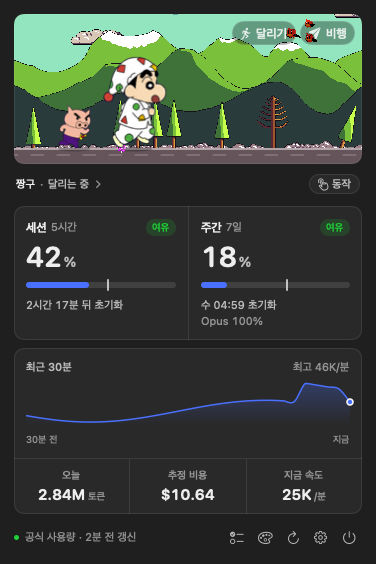
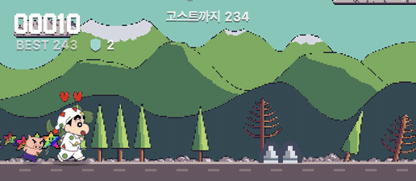
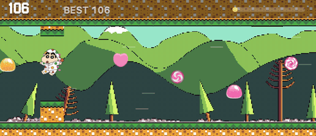

# RunTime 자세한 사용법

처음 쓰는 법은 [README](../README.md)에 있습니다. 여기에는 화면과 기능을 하나씩 적었습니다.

## 메뉴바 러너

러너는 최근 1분 동안 쓴 토큰 양에 맞춰 움직입니다.

| 모습 | 분당 토큰 |
| --- | --- |
| 잠자기 | 5분 넘게 쓰지 않음 |
| 걷기 | 1 ~ 2,000 |
| 달리기 | 2,000 ~ 10,000 |
| 질주 | 10,000 ~ 30,000 |
| 전력 질주 (빛 꼬리) | 30,000 넘게 |

설정의 민감도를 낮음으로 하면 기준이 두 배, 높음으로 하면 절반이 됩니다.
같은 단계 안에서도 많이 쓸수록 걸음이 빨라져, 단계가 바뀌는 순간 덜 덜컥입니다.

사용량 흐름에도 반응합니다. 메뉴바 러너가 동작을 하고, 사용량 창이 열려 있으면 무대 러너가 말풍선으로 알려 줍니다.

| 순간 | 동작 |
| --- | --- |
| 토큰이 갑자기 쏟아질 때 (몇 초 사이 세 배 넘게) | 부스트 질주 |
| 몇 분 쉬었다가 다시 쓸 때 | 기지개 |
| 세션 사용률이 25·50·75%를 넘을 때 | 사용률 고리가 차오름 |
| 두 폴더 이상에서 동시에 쓸 때 | 춤 |
| 5시간 세션이 새로 시작될 때 | 축하 |

반응 사이에는 15초를 쉬고, "가끔 혼자 장난치기"를 끄면 반응도 하지 않습니다.

Claude Code가 대답을 마치면 메뉴바 러너가 축하 동작을 합니다. 사용량 창이 열려 있으면 러너가 말풍선으로,
미니게임 중이면 판을 멈추지 않고 화면에 "Claude 작업 끝"과 폴더 이름을 띄웁니다. 사용량 창이 닫혀 있고 1분 넘게 걸린 작업이면 macOS 알림도 보냅니다(설정 > 사용량에서 끌 수 있습니다).
한 주가 끝나면 지난 7일의 토큰, 비용, 가장 많이 쓴 날과 프로젝트를 알림으로 한 번 요약해 줍니다.
알림을 누르면 사용량 창이, 주간 요약 알림을 누르면 앱 창의 사용량 화면(최근 8일)이 열립니다.
주의 경계는 공식 주간 초기화 시각이고, 공식 연동을 끄면 월요일 0시입니다.
기다리는 동안 한 판 하기 좋습니다.

세션이나 주간 사용률이 80%를 넘어도 토큰을 쓰는 동안에는 속도대로 달립니다. 80%면 달리며 숨을 몰아쉬고, 95%면 빨갛게 달리며 머리 옆에 경고 점이 붙습니다. 쉬는 동안에는 80%면 앉아서 헐떡이고, 95%면 빨갛게 멈춰 서서 경고 점이 퍼집니다. 사용량 창 무대도 함께 어두워집니다.
마우스를 올리면 지금 사용률이 툴팁으로 나옵니다. 러너를 누르거나 어느 앱에서든 ⌃⌥U를 누르면 사용량 창이 열리고, 오른쪽 클릭(또는 control 클릭)하면
사용량·계정, 업무 일지·레드마인, 디자인·호스트, 러너와 게임, 설정으로 묶인 빠른 메뉴가 뜹니다.

처음 설치하면 러너는 다른 앱 아이콘들의 오른쪽 끝(시계와 제어 센터 바로 왼쪽)에 놓이고, 로그인할 때 자동으로 켜집니다.
쓰는 법을 알려 주는 안내 창도 한 번 뜹니다. 자동 시작은 설정 > 일반에서 끌 수 있습니다.

메뉴바에는 기본으로 러너만 보입니다. 설정 > 일반에서 "메뉴바에 사용률 표시"를 켜면 러너 바로 옆에 사용률 숫자가 붙습니다.

## 사용량 창

러너를 누르면 열립니다.



- 이름 옆 배지는 지난 시간에 견준 사용 속도입니다. 사용률이 지난 시간 비율보다 10%p 넘게 앞서면 빠름, 뒤처지면 여유,
  95%를 넘으면 한도 임박입니다. 최근 속도로 초기화 전에 한도에 닿을 것 같으면 빠름으로 올라갑니다.
- 막대 위의 흰 눈금은 시간이 얼마나 지났는지입니다. 막대가 눈금보다 앞서 있으면 시간보다 빨리 쓰고 있다는 뜻입니다.
- "약 1시간 12분 뒤 한도"는 최근 30분 동안 오른 속도로 계산합니다. 초기화가 먼저 오면 "초기화 전까지 여유"로 나옵니다.
- 주간 아래에는 어디서 썼는지(Claude Code, 채팅 등) 비율이 나옵니다.
- 최근 30분 그래프에 마우스를 올리면 그 분에 쓴 토큰이 나옵니다.
- 오늘 토큰, 예상 비용, 지금 속도는 이 Mac의 Claude Code 기록으로 셉니다. 비용은 API 단가로 계산한 참고값입니다.
- 아래 단추는 왼쪽부터 앱 창에서 열기, 업무 일지, 디자인 변경(완료된 시안에 확인하지 않은 변경이 있으면 파란 점), 새로고침, 설정, 종료입니다. 날짜별 사용량은 앱 창의 사용량 화면 아래쪽에 있고, 하루 평균과 최근 8일의 날짜별 막대, 평균선, 프로젝트(Claude Code를 연 폴더)별 사용량이 나옵니다.
- 무대의 러너를 누르면 장난을 치고, 메뉴바 러너도 같이 따라 합니다. 오른쪽 "동작"에서 고른 동작도 무대와 메뉴바 러너가 함께 합니다.

사용률이 `--`로 나오면 공식 값을 받지 못한 것입니다. 이유는 창 아래 상태 줄에 나옵니다.
이때는 추정값을 보여 주지 않고 비워 둡니다. 속도와 오늘 사용량은 계속 보입니다.

## 펫 고르기

사용량 창에서 펫 이름(`짱구 ›`)을 누르거나 앱 창 왼쪽 "러너"를 열면 펫 탭이 나옵니다. 위 무대에서 고른 펫이 바로 달립니다.
아래 "색상"으로 색을 입히거나 "아무거나"로 무작위로 고를 수 있습니다.

- 기본 펫 5종: 고양이, 강아지, 꼬마 공룡, 소녀, 호박 잭
- Petdex 펫: "내 펫" 오른쪽 "Petdex에서 받기"를 누르면 5천여 종을 찾는 창이 열립니다. 처음부터 "전체"에서 찾고, `짱구`, `피카츄`, `검은 고양이`처럼 한글로도 찾습니다.
  이름은 한국어로 보이고, 공식 이름표에 없는 이름은 Claude가 한 번 다듬어 저장합니다. 새로 올라온 펫은 1시간 안에 목록에 들어오고, 창의 ↻로 바로 받을 수도 있습니다.
- 내가 만든 펫: "펫 만들기"로 그린 펫과 `~/.codex/pets`, `~/.petdex/pets`, `~/.runtime/pets`에 새로 생긴 펫이 저절로 들어옵니다.
- 내 그림: 펫 탭 맨 아래 "내 그림(GIF·PNG)으로 만들기"로 GIF나 PNG 여러 장(파일 이름 순서)을 넣으면 바로 펫이 됩니다.
- "내 펫 찾기"는 가진 펫만 이름으로 거릅니다.
- 펫을 오른쪽 클릭하면 동료로 데려가기, 이름 바꾸기, 삭제를 합니다. 동료는 무대와 게임에서 펫 뒤를 따라 달립니다.
- 메뉴바 크기는 3단계(작게·보통·크게)입니다. 메뉴바가 좁으면 "작게"를 고르세요.

## 펫 만들기

펫 탭 맨 위 "펫 만들기" 카드에서 합니다.

1. 만들 펫을 적습니다. 생김새(`분홍 리본 고양이`)도 되고 캐릭터 이름(`훈이`)도 됩니다.
2. 원작 캐릭터를 똑같이 만들려면 그림을 카드에 끌어다 놓거나 붙여 넣거나 "+ 그림"으로 고릅니다(세 장까지). 다른 각도의 그림을 섞으면 옆모습이 더 닮습니다.
   그림을 넣지 않으면 Claude가 웹에서 그 캐릭터 그림을 찾아 맞는지 확인한 뒤 따라 그립니다. 못 찾으면 글로만 그리고 원작과 다를 수 있다고 알립니다.
3. "만들기"를 누릅니다. 진행 화면에 지금 단계, 진행 막대(예: 3/9), 남은 시간, 지금까지 그린 그림이 차례로 나옵니다. "멈추기"로 언제든 그만둘 수 있습니다.
   기본 모습 → 옆모습(두 장 중 Claude가 부위가 더 붙지 않은 쪽을 고름) → 서 있기, 걷기, 손 흔들기, 점프, 시무룩, 기다리기, 살펴보기 순서로 그리고 Petdex와 같은 규격으로 묶습니다.
4. 다 되면 바로 그 펫이 달립니다. 마음에 안 들면 "고칠 점"에 `빨간 모자를 씌워 줘`처럼 적고 "고치기"를 누르세요. 그 부분만 바꿔 다시 그리고 지금 펫과 바꿉니다. "다시 그리기"는 같은 설명으로 처음부터 그립니다.
5. "Petdex에 올리기"를 누르면 공식 CLI(`npx petdex`)로 올립니다. 처음 한 번은 브라우저에서 Petdex에 로그인하고, 심사 결과는 이메일로 옵니다. 하루 10개까지 올릴 수 있습니다. Node가 없으면 다운로드 폴더에 zip을 만들고 Petdex 제출 페이지를 엽니다.

처음 한 번 그림 도구와 FLUX.2 klein 4B 모델(약 5GB)을 받습니다. 그다음부터는 한 마리에 6~8분 걸립니다.
파이썬 3.10 이상이 필요하고(`brew install python`), 펫 탭 맨 아래 "펫 만들기 모델 지우기"로 모델을 지울 수 있습니다.

## 게임

<p align="center">
  
  
</p>

무대 오른쪽 위 "달리기"나 "비행", 또는 러너 화면의 게임 탭에서 시작합니다. 앱 창에서는 게임을 켜면 탭이 사라지고 무대가 창 폭만큼 커집니다(장면 비율은 그대로라 점수 조건은 같습니다). esc로 나갑니다.

### 달리기

- 스페이스, ↑, W, 클릭으로 점프합니다. 길게 누를수록 높이 뜁니다.
- ↓나 S, 또는 오른쪽 버튼을 누르고 있으면 숙여서 낮게 나는 박쥐를 피합니다.
- ←→나 A·D로 앞뒤로 움직입니다. 뛰는 중에 →를 누르면 더 멀리 넘습니다.
- 갈수록 빨라지고 장애물이 촘촘해집니다. 굴러오는 가시공은 빨리 다가오고, 머리 위의 로봇 상자는 가까이 가면 내리찍습니다. 반응만 빠르면 어느 판이든 넘을 수 있게 배치합니다.
- 게임 탭에서 이단 점프, 보호막, 자석, 글라이드 능력을 켜고 끕니다(다음 판부터 적용).
- 가장 잘한 판은 고스트로 남습니다. 시작 화면이나 끝난 화면에서 G를 누르면 그 판과 같은 코스에서 고스트와 겨룹니다(겨룬 점수는 최고 점수에 넣지 않습니다).

### 비행

- 스페이스, ↑, 클릭을 누르는 동안 올라가고 떼면 내려옵니다. →나 오른쪽 클릭을 누르는 동안 빨라지고 점수가 더 오릅니다.
- 쉬움, 보통, 어려움 가운데 고르고, 난이도마다 최고 점수가 따로 남습니다.
- 멀리 갈수록 빨라지고, 기둥 문, 지그재그 벽, 떠 있는 바위, 박쥐 떼, 움직이는 문, 떨어지는 상자, 튀는 가시공, 계단 문, 마주 오는 드릴, 좁은 굴, 붙으면 잠깐 무거워지는 슬라임이 무작위로 나옵니다. 같은 조각은 잇달아 나오지 않고, 지나갈 길이 없는 배치는 만들지 않습니다.
- 사탕을 먹거나 장애물을 아슬아슬하게 피하면 점수가 오르고, 보호막을 먹으면 한 번 막아 줍니다. 구역이 바뀔 때마다 배경과 블록이 바뀝니다.

## 꾸미기

러너 화면의 꾸미기 탭에서 고릅니다. 모든 물건은 조건 없이 고르고 뗄 수 있고, 고르면 무대에 바로 보입니다. 쓰는 것을 다시 누르면 뗍니다.

| 갈래 | 고를 수 있는 것 |
| --- | --- |
| 배경 | 숲·눈, 언덕·마을, 사막, 바다, 하늘, 도시·밤, 동굴에서 59종. 마우스를 올리면 무대에서 미리 봅니다 |
| 꼬리 | 무지개 별, 하트, 보석, 코인, 사탕 등 12종 |
| 발먼지 | 반짝반짝, 하트, 별, 코인 등 8종 |
| 부딪힘 | 하트 펑, 별 폭발, 코인 비 등 9종 |

## 업무 일지

러너를 오른쪽 클릭해 "업무 일지"를 고르거나, 사용량 창 아래 체크리스트 단추를 누르면 열립니다.
하루 한 일을 프로젝트별로 적어 두면 오른쪽에 일일보고와 레드마인 댓글이 만들어지고, 단추 하나로 복사합니다.

| 하고 싶은 것 | 방법 |
| --- | --- |
| 일 적기 | 프로젝트 카드 맨 아래 칸에 쓰고 Enter. 끝에 `(60%)`, `(상시)`를 붙이면 상태로, `#1234`를 붙이면 레드마인 일감 번호로 저장 |
| 상태 바꾸기 | 줄 왼쪽 상태 표시를 누르고 완료·100%·10% 단위·상시 가운데 고름. 오른쪽 클릭으로도 바꿈 |
| 일감 번호·댓글 | 줄 오른쪽 말풍선 단추. 댓글을 비우면 내용 한 줄로 `[작업 내용]`을 만들고, "양식 넣기"로 `[연동 API]`·`[비고]` 머리를 넣음 |
| 써 둔 보고서 넣기 | 위 막대 더 보기(⋯) > "보고서 붙여넣기"에 `1. 프로젝트` 아래 `- 내용 (완료)` 꼴의 글을 붙여 넣음 |
| 어제 이어서 | 더 보기(⋯) > "끝나지 않은 일 이어 쓰기"는 바로 앞 기록일에 끝나지 않은 일을 이 날로 가져옴 |
| 일일보고 복사 | 오른쪽 "진행 사항 복사" (⇧⌘C). 맨 앞에 `[11/03 금일 진행 사항]` 머리를 붙이고 상시 → 완료 → 진행 순서로 적음. "Claude로 다듬기"로 짧게 고칠 수 있음 |
| 어디서든 한 줄 적기 | ⌃⌥L. 프로젝트를 고르고 쓰고 Enter. 러너 오른쪽 클릭 메뉴의 "업무 한 줄 적기"도 같음 |
| 날 이동 | ⌘[ 이전, ⌘] 다음, ⌘T 오늘, ⌘R 새로고침(GitLab과 레드마인 일감 다시 받기), ⌘F 찾기, ⌘N 할 일 추가 칸으로 |
| 줄 순서 바꾸기 | 줄에 마우스를 올리면 왼쪽 바깥에 나오는 손잡이를 끌어 같은 프로젝트 안 다른 줄 위에 놓음. 보고서 줄 순서가 이 순서 |
| 날짜 고르기 | 왼쪽 달력. 칸 아래 색 점이 그날 적은 프로젝트. 토요일은 파랑, 일요일·공휴일은 빨강이고 공휴일 이름은 마우스를 올리면 나옴. 화살표로 달을 넘김 |
| 프로젝트 만들기 | 왼쪽 "프로젝트" 옆 +. 이름을 쓰고 Enter를 누르면 고른 날에 카드가 열림 |
| 찾기 | 왼쪽 맨 위. 내용·댓글·프로젝트·`#일감번호`에서 찾고 초성(`ㄷㅇㅌ`)으로도 찾음. 결과를 누르면 그날로 감 |
| 주간 보고 | 위쪽 "주간". 같은 일은 한 줄로 모으고 그 주 마지막 상태를 씀. 줄마다 `40% → 100%`처럼 진행이 보임. "끝나지 않은 일을 [차주 계획]으로"를 켜면 끝에 차주 계획이 붙음 |
| 월간 보고 | 위쪽 "월간". 주간과 같은 규칙으로 한 달을 모아 `[월간 진행 사항] 2026년 10월`로 복사 |
| 달력으로 보기 | "월간" 제목 오른쪽 "달력"(고른 보기는 기억함). 칸마다 그날 적은 일, 공휴일 이름, 나에게 배정된 레드마인 일감의 마감(빨간 깃발)이 보이고, 이번 달을 볼 때는 마감이 지난 내 일감 수를 달력 위에 모아 보이며, 날짜 옆 주황 종이비행기 숫자는 레드마인에 아직 안 보낸 줄 수. 위쪽 프로젝트를 누르면 그 프로젝트만 남고 요약 숫자도 그 프로젝트로 셈. 칸을 누르면 그날 일지로, 왼쪽 "1주"·"2주"를 누르면 그 주의 주간으로 감. 공휴일은 2024~2027년 표를 씀 |
| 프로젝트별 기록 | 왼쪽 프로젝트 이름을 누름. 아직 끝나지 않은 일과 날짜별 기록 |
| 프로젝트 순서 바꾸기 | 왼쪽 프로젝트 목록에서 프로젝트를 끌어 다른 프로젝트 위에 놓음. 보고서 번호 순서도 같이 바뀜(오른쪽 클릭의 "보고서에서 위로·아래로"와 같음) |
| 프로젝트 숨기기 | 왼쪽 프로젝트를 오른쪽 클릭하거나 카드 메뉴에서 "목록에서 숨기기". 왼쪽 목록, 적을 프로젝트 고르기, 달력 점에서 빠지고 "숨긴 프로젝트"에 모임. 기록과 보고서에는 그대로 남고, 하루·주간 보기 아래 "숨긴 프로젝트 보기"로 펼쳐 봄 |
| 레드마인 올리기 | 오른쪽 "레드마인" 탭의 "레드마인에 보내기". 다른 곳에서 이미 올렸으면 "보낸 것으로 표시", Claude Code로 올리려면 "Claude용 복사". 올린 뒤 고친 줄은 다시 목록에 들어옴 |

끝난 일은 보고서 꼴에 맞춰 "완료"와 "100%" 가운데 고를 수 있습니다.

### 레드마인 화면과 레드마인 기준 보고서

앱 창 왼쪽 "레드마인"(⌘4)에서 웹에 가지 않고 일감을 봅니다. 왼쪽에서 내 일감, 내가 등록한 일감, 프로젝트를 고르고 오른쪽 위 "저장한 질의"로 레드마인에 저장한 질의를 불러옵니다.
표는 칸 머리를 눌러 정렬하고, 열린·닫힌·모든 일감과 안정화·QA·기한 임박·담당 없음으로 거르며, "트리"를 켜면 하위 일감을 들여 씁니다.
일감을 누르면 큰 창이 열립니다. 상태·우선순위·담당자·날짜·진척률은 그 자리에서 고치면 바로 보내고, 레드마인이 받지 않으면 값을 되돌리고 까닭을 알립니다.
이력은 전체·댓글·변경 내역으로 나눠 보고, 아래 칸에 댓글을 쓰면 ⌘↩로 올립니다. ⌘[ ⌘]로 앞뒤 일감을 옮기고 esc로 닫습니다.
"새 일감"(⌘N)으로 일감을 만들고, 일감 창의 "시간 기록"으로 소요 시간을 남기며, "오늘 일지에 넣기"로 오늘 일지에 줄을 넣습니다.
오른쪽 "목록·트리·일정·보드·달력"으로 보기를 바꿉니다. 트리는 내 일감의 상위까지 받아 옅게 보이고, 일정은 기간을 막대로 보입니다(빨강은 기한 지남, 세로선은 오늘). 보드는 카드를 끌어 놓으면 상태가 바뀌고, 달력은 기한 날에 일감을 둡니다.
"거르기"로 상태·트래커·담당자·우선순위·프로젝트를 고르고, 그 옆 단추로 보일 칸과 묶는 기준을 정합니다. 줄을 ⌘클릭으로 고르면 아래 막대에서 상태·진척률·우선순위·담당자를 한 번에 고칩니다.
찾는 칸에 치면 지금 목록을 거르고, Enter를 누르면 모든 프로젝트에서 찾습니다. `#123`처럼 번호를 치고 Enter를 누르면 그 일감을 바로 엽니다.
일감 창에서는 제목·설명·트래커·추정 시간 고치기, 하위 일감 만들기, 일감 복사·지우기, 관계 더하기·지우기, 지켜보기, 파일 첨부도 합니다. 그림 첨부는 앱 안에서 보고, 댓글의 ⋯에서 인용·고치기·지우기를 합니다. 목록·표·링크가 있는 설명은 서식을 잃지 않게 HTML 그대로 고칩니다. 댓글 칸은 창 아래에 늘 있습니다.

저장소·문서·포럼처럼 레드마인이 API를 주지 않는 화면은 "웹에서 열기"로 엽니다.

보고서는 레드마인 일감 이름으로 적고, 상태 괄호는 레드마인에 보낸 값(아직 보내지 않았으면 보낼 값)으로 적습니다. 일감이 `구현 > 데이터 수집 > 공유 파일 관리 > API 연동`처럼 쌓여 있으면
`데이터 수집 > 공유 파일 관리 API 연동 (100%)`으로, `시험 > 기능 테스트` 아래 일감은 프로젝트마다 `QA 수정사항 N건 반영 (완료)`, 안정화 일감은 `안정화 이슈 N건 처리 (완료)` 한 줄로 셉니다.
같은 일감을 여러 커밋·MR로 했으면 한 줄로 모으고, 일감이 없는 줄(회의 등)은 적은 그대로 둡니다.
"간결하게 쓰기"를 켜 두면 같은 메뉴의 줄을 한 줄로 모으고, 같은 일을 나눈 커밋은 한 줄로, 되돌린 일은 빼고 씁니다.
일지 화면은 디자인 메뉴 트리처럼 경로를 마디마다 나눠 묶습니다. 줄이 둘 이상 모인 마디(`데이터 탐색` 아래 `SQL 편집기`, `BI 대시보드` 등)가 꺾쇠와 줄 수가 붙은 묶음이 되고, 아래가 하나뿐인 경로는 `데이터 탐색 › SQL 편집기`처럼 한 줄로 합칩니다. 줄에는 묶음 아래 이름만 보이고, 혼자인 줄은 이름 뒤에 남은 경로를 옅게 붙입니다. 묶음 머리를 누르면 접고 펴며, 더 보기(⋯)의 "모든 묶음 접기·펼치기"도 함께 따릅니다. 보고서는 지금처럼 같은 경로끼리만 묶어 씁니다.

레드마인 프로젝트 이름은 보고서에서 길어서, 레드마인 화면에서 프로젝트를 고른 뒤 제목 옆 "보고서 이름"에서 `VeloX`, `uxhub`처럼 정합니다. 정하지 않으면 그 프로젝트 일감을 적은 일지 프로젝트 이름을 씁니다.
일감 번호가 없는 줄은 말풍선 창의 "맞을 만한 일감"에서 고르면 이어집니다.

### GitLab에서 저절로 가져오기

앱 창 왼쪽 설정 > 업무 일지 > GitLab에서 GitLab 주소(glab에 로그인한 곳)와 저장소 폴더를 정하고 "머지한 MR과 커밋을 10분마다 가져오기"를 켭니다.

- 머지된 내 MR은 머지한 날에 완료로 들어옵니다. 제목·설명의 `#12345`가 일감 번호가 됩니다.
- MR 설명은 리뷰어에게 쓴 글이라 손으로 올리던 레드마인 댓글 꼴로 다듬습니다. `[확인 방법]`과 줄 안의 일감 번호를 빼고, `[비고]` 맨 앞에 `- MR !110`을 두고, 코드 이름이 든 `[비고]` 줄은 뺍니다.
- MR 맨 위에 `[일감]` 칸(`- #37742 상품 신청 내역 > API 연동`)을 두면 적힌 일감마다 줄을 만들고, 내 일감에 없는 일감도 적은 이름을 줄 제목으로 씁니다. `[일감]` 칸은 댓글에 올리지 않습니다.
- 머지 뒤에 MR 설명을 고치면(`[일감]`을 나중에 단 경우 등) 아직 보내지 않은 줄은 다음 가져오기에서 새 설명으로 다시 만듭니다. 손으로 고친 댓글과 보낸 줄은 그대로 둡니다.
- 같은 날 같은 일감 줄이 이미 있어도 MR마다 줄을 따로 둡니다. 보낼 때는 일감별로 한 댓글로 모입니다.
- MR 하나가 일감 여럿을 다루면 일감마다 줄을 나누고, 줄마다 그 일감 이야기만 남깁니다(번호가 적힌 줄과 그 아래 줄, 일감 제목과 낱말이 겹치는 줄). 댓글을 고치지 않았으면 일감 제목을 받은 뒤 다시 나눕니다.
- 아직 main·dev·release에 들어가지 않은 내 커밋은 브랜치마다 한 줄로 진행중이 됩니다. 그 MR이 같은 날 머지되면 그 줄이 완료로 바뀝니다.
- chore·docs·ci·style·test 커밋은 넣지 않습니다. 브랜치 이름의 숫자는 다섯 자리 이상이거나 `#`가 붙을 때만 일감 번호로 봅니다.
- 고친 제목·댓글은 다시 가져와도 덮어쓰지 않고, 지운 줄은 되살리지 않습니다.
- 프로젝트 이름은 GitLab 묶음 이름(velox, cdh)으로 들어옵니다. 카드 메뉴에서 이름을 바꾸면 다음부터 그 이름으로 들어옵니다.

### 레드마인에 보내기

설정 > 업무 일지 > 레드마인에서 "Claude 설정에서 가져오기"를 누르면 redmine MCP의 주소와 API 키를 키체인으로 옮깁니다(직접 넣어도 됩니다).
그 뒤 레드마인 탭의 "레드마인에 보내기"를 누르면 앱이 레드마인 API로 진척률과 댓글을 올립니다. Claude 토큰은 쓰지 않습니다.
카드마다 체크가 있어 고른 일감만 보내고, "Claude용 복사"와 "보낸 것으로 표시"도 고른 일감에만 적용됩니다.
카드에는 레드마인의 지금 진척률과 보낼 값이 `40% → 80%`로 나오고, 낮추게 되면 주황색으로 표시하고 보내기 전에 한 번 더 묻습니다.
긴 댓글은 "펼치기"로 다 보고, "댓글 고치기"로 그 줄의 댓글 칸을 바로 엽니다.
Claude 등으로 이미 올린 댓글과 비슷한 글이 그 일감에 있으면(일지에 적은 날 사흘 전부터) 카드에 "레드마인에 비슷한 댓글이 이미 있습니다"가 뜨고 체크가 풀립니다. "보낸 것으로 표시"로 정리하거나, 다시 체크하면 그대로 보냅니다.

잘못 고른 일감은 카드의 ⋯에서 "일감 번호 바꾸기", "일감 연결 끊기"(줄은 남기고 번호만 뗌), "보낸 것으로 표시"로 뺍니다.

댓글은 손으로 쓴 댓글과 같은 HTML 꼴(`[작업 내용]`마다 문단, 줄마다 줄바꿈)로 보냅니다. 웹 편집기를 쓰는 레드마인은 평문 줄바꿈을 한 줄로 붙이기 때문입니다.
설정의 "댓글을 HTML로 보내기"로 끄고 켜며, "Claude용 복사" 글과 `--worklog redmine`도 같은 꼴을 씁니다.

보내기 직전에 일감의 지금 값을 다시 읽어 바꿀 칸을 정하고, 보내기 전 값을 함께 남깁니다. 레드마인 탭의 "보낸 기록"에서 잘못 보낸 건을 "되돌리기"하면
앱이 바꾼 진척률·상태·날짜·담당자를 보내기 전 값으로 돌리고 보낸 댓글을 지웁니다. 이 레드마인처럼 댓글 수정 API가 없는 레드마인(5.0 아래)은 그 댓글 자리를 브라우저로 열어 주니 연필 > 지우기로 지웁니다. 보낸 뒤 다른 사람이 바꾼 칸은 그대로 두고, 그 줄들은 다시 보낼 목록으로 돌아옵니다.

설정의 "상태·날짜도 맞추기"(기본 켜짐)는 보낼 때 일감 상태와 날짜도 일지에 맞춥니다. 진행으로 적으면 할일 상태의 일감을 처리중으로,
완료로 적으면 완료로 옮기고(옮길 상태는 설정에서 고름), 시작일은 비어 있을 때 일지에 처음 적은 날로, 완료 기한은 완료했는데 비어 있을 때 마지막으로 적은 날로 채웁니다.
테스트·반려·코드리뷰처럼 그 밖의 상태인 일감은 건드리지 않고, 이미 있는 날짜를 덮어쓰지 않습니다. 바뀔 칸은 카드에 `할일 → 완료`, `시작 10.19`처럼 미리 보입니다.
레드마인이 상태 변경을 받지 않으면 상태·날짜만 빼고 댓글과 진척률을 보냅니다.

상태·시작일·완료 기한·담당자는 직접 고를 수도 있습니다. 카드의 "상태·날짜·담당자"(바꿀 칸이 있으면 "고치기")를 눌러 고르면 자동 값보다 앞서고,
직접 고른 칸은 칩이 진하게 보입니다. 담당자는 그 레드마인 프로젝트 구성원 가운데서 고릅니다. 시작일이 기한보다 늦으면 미리 알립니다.
댓글 없이 칸만 바꾸려면 레드마인 화면의 일감 창에서 고칩니다.
줄 편집 창의 "내 일감"에서 나에게 배정된 열린 일감을 골라 번호를 넣을 수 있습니다.


### 팀즈 채팅에 보내기

팀즈 채팅 목록에서 보낼 채팅(나에게 보내려면 내 이름 옆 "(나)" 채팅)의 ⋯ > 워크플로 > "웹후크 경고를 채팅으로 보내기" 템플릿을 고르고 저장합니다.
채팅용 웹훅 템플릿은 워크플로 앱 목록에는 없고 채팅의 ⋯ 메뉴에서만 보입니다.
만든 흐름의 편집 > "팀즈 웹후크 요청을 받은 경우"에서 "흐름을 트리거할 수 있는 사람"을 "누구나"로 바꿔 저장합니다. 기본값(회사 사용자만)이면 OAuth를 요구해 401로 막힙니다.
웹훅 주소를 설정 > 팀즈의 "붙여넣기"로 넣습니다(키체인에 저장).
"시험 글 보내기"로 카드가 오는지 먼저 봅니다. 그 뒤 보고서 칸의 "팀즈 채팅에 보내기"를 누르고 한 번 더 확인하면 일일·주간·월간 보고가 카드로 갑니다.

### 고정 업무

설정의 고정 업무에 프로젝트, 내용, 요일을 넣으면 그 요일마다 일지에 저절로 들어갑니다(기본 상시). 그날 지우면 다시 넣지 않습니다.

알림을 켜 두면 평일 정한 시각(기본 18:00)에 한 번 더 가져온 뒤 "오늘 업무 일지 n줄 · 보낼 일감 m개"를 알리고, 누르면 레드마인 탭이 열립니다.

일지는 `~/Library/Application Support/RunTime/worklog.json`에 저장합니다. 터미널이나 Claude Code에서는
JSON을 읽지 않고 아래 명령으로 필요한 글만 받습니다. 명령으로 고치면 열린 창에도 바로 보입니다.

```bash
RT=/Applications/RunTime.app/Contents/MacOS/RunTime
$RT --worklog day [yyyy-MM-dd]          # 일일보고
$RT --worklog week [yyyy-MM-dd]         # 주간 보고
$RT --worklog redmine [week]            # 아직 안 올린 일감별 진척률과 댓글
$RT --worklog add VeloX "삭제 API 연동" 70% "#4513" [--day 2026-10-20] [--note "[작업 내용]\n- ..."]
pbpaste | $RT --worklog import          # 써 둔 보고서 넣기
$RT --worklog posted 4512 4513 [week]   # 올린 것으로 표시 (redmine과 같은 범위)
$RT --worklog capture                   # GitLab MR과 로컬 커밋을 지금 가져오기
$RT --worklog issues                    # 나에게 배정된 레드마인 일감과 보고서 이름 (MCP 없이)
$RT --worklog teams-test [report]       # 팀즈 채팅으로 시험 카드(report면 오늘 일일보고) 보내기
```

## 디자인 변경 기록

피그마 화면설계서에서 어느 메뉴의 어느 화면이 언제 바뀌었는지 날짜별로 모읍니다. 앱 창 왼쪽 "디자인"(⌘5)이나 러너 오른쪽 클릭 메뉴의 "디자인 변경"으로 열고, 확인하지 않은 변경이 있으면 메뉴에 건수가 붙습니다.

처음 열면 연결 안내가 나옵니다. "피그마 연결하기"(또는 설정 > 디자인 > 피그마)에서 피그마 설정 > Security > Personal access tokens에서 `file_content:read` 범위(날짜 비교까지 쓰려면 `file_versions:read`도)로 만든 토큰을 넣고, 피그마 링크를 붙여 넣습니다.
처음 가져온 상태가 기준이 되고, 그다음 가져올 때부터 바뀐 것을 기록합니다.

### 메뉴 하나만 가져와 마크업하기

마크업할 메뉴가 정해져 있으면 프로젝트 전체 대신 그 메뉴만 가져옵니다.

- 왼쪽 메뉴에 마우스를 올리면 나오는 ↓, 메뉴 오른쪽 클릭 > "이 메뉴만 가져오기", 또는 메뉴를 고른 채 ⌘R을 누릅니다. 묶음(예: `계정 관리`)을 고르면 그 아래 메뉴를 함께 받습니다.
- 그 메뉴 화면이 있는 페이지만 살펴보고 그 메뉴 화면만 받아서, 프로젝트 전체를 받을 때보다 피그마 요청이 훨씬 적습니다. 그 화면들이 그대로면 파일 정보만 한 번 묻고 끝납니다.
- 메뉴만 받아도 프로젝트의 확인 시각은 그대로라, 다음에 프로젝트를 가져올 때 다른 메뉴의 변경을 놓치지 않습니다. 다른 페이지에 새로 생긴 화면은 프로젝트를 가져와야 보입니다.
- 한 번도 가져오지 않은 프로젝트나 링크로 고른 화면만 보는 프로젝트는 메뉴로 나눌 수 없어 프로젝트를 가져옵니다.

메뉴를 고르면 가운데 위에 그 메뉴의 화면 수, 구현 진행(구현 체크한 기능 명세 수), 반영할 변경 수, 마지막으로 확인한 때가 나오고 "이 메뉴 가져오기" 단추가 있습니다.
반영할 변경이 있으면 "변경 n건 Claude 문구"로 그 메뉴 화면들의 변경을 화면별로 묶어 한 번에 복사합니다. 화면마다 전체 기능 명세 대신 피그마 링크를 넣어 글이 짧습니다.
반영할 변경이 없으면 같은 자리 단추가 "메뉴 마크업 Claude 문구"로 바뀌어, 화면마다 피그마 링크·참고·남은 기능 명세를 묶어 복사합니다(구현을 마친 화면은 빼고, 목업 문구와 배치는 Claude가 피그마 MCP로 읽게 해 글을 줄임). 칸이 좁으면 단추 이름이 짧아집니다.
메뉴를 고르면 그 메뉴의 첫 화면이 바로 열립니다. 화면 아래 가운데 떠 있는 막대에서 일을 끝냅니다. ∧ ∨(⌥↑·⌥↓)는 가운데 목록 순서대로 앞뒤 화면이나 변경을 넘기고(아무것도 고르지 않았으면 첫 항목을 엶), 옆은 "이 화면(변경) Claude 문구"와 "반영 완료"(⌘↩)입니다. 긴 상세를 내려 읽다가도 위로 올라가지 않고 누릅니다. 가운데 위 "메뉴 문구"는 메뉴 전체, 아래 막대의 문구는 지금 보는 화면 하나를 정리합니다.

변경 목록은 날짜 띠(위에 붙어 따라옴) 아래에, 같은 날 같은 화면의 변경을 일감 트리처럼 한 묶음으로 모읍니다. 묶음 머리에는 화면 이름, 변경 수, 가장 최근 시각이 있고, 누르면 접고 펼칩니다. 화면 ID는 목록에서 빼고 줄에 올렸을 때와 상세에만 보입니다.

여러 변경을 한 번에 넘기려면 변경 목록 줄에 마우스를 올려 왼쪽에 나오는 체크칸을 누릅니다. 하나라도 체크하면 모든 줄에 체크칸이 나오고 줄을 눌러도 체크만 바뀌며, 아래 막대가 "n건 선택 · 전체 · Claude 문구 · 반영 완료 n"(⌘↩)으로 바뀝니다. 20건 넘게 고르면 한 번 묻고, "반영 완료" 목록에서 고르면 "반영 완료 풀기"가 됩니다. ×나 esc로 체크를 모두 풉니다.
화면 상세 위에는 그 화면의 "반영할 변경"이 모여 있어 눌러서 전·후 비교로 가고, 마크업을 마치면 아래 막대의 "모두 반영 완료"(⌘↩)로 한 번에 넘긴 뒤 목록의 다음 화면이 열립니다. 반영할 변경으로 바뀐 목업 문구는 그 아래 "바뀐 목업 문구"에 이전 → 이후로 모여, 이전 글(돋보기)로 코드에서 찾고 바뀐 글을 복사해 붙입니다(처음 6줄, 나머지는 "더 보기"). 나머지 목업 문구는 화면 위쪽·가운데·아래쪽으로 나뉘어 줄을 누르면 복사되고, 필수 표시(*)와 표 예시 데이터는 뺍니다. 기능 명세 항목에 올리면 나오는 복사 단추로 항목 글을 복사합니다.
화면 탭의 "끝난 화면 숨기기"를 켜면 기능 명세를 모두 구현 체크했고 반영할 변경도 없는 화면이 목록에서 빠져 남은 화면만 보입니다(탭에 "화면 6/7"처럼 표시되고, 위 요약은 메뉴 전체 기준 그대로). 상세 머리의 화면 ID를 누르면 복사되고, 화면 상세 ⋯의 "구현 체크리스트 복사"는 기능 명세를 `- [x]`·`- [ ]` 꼴로 복사해 MR 설명에 붙입니다.
상세는 칸을 나누지 않고 한 칸으로 쌓고, 칸 사이 경계를 끌어 너비를 자유롭게 정합니다(업무 일지도 같음). 넓히면 전·후 화면 비교가 나란히, 좁히면 위아래로 놓입니다.
그 아래 "화면 | 변경"에서 지금 시안 화면 목록과 변경 목록을 바꿔 봅니다. 화면 목록은 메뉴마다 작은 머리로 나뉘고, 줄마다 반영할 변경 수와 "구현 2/5" 같은 진행이 붙습니다. 다른 메뉴를 고르면 오른쪽 상세에 남아 있던 다른 메뉴의 변경은 비웁니다.

### 작업할 화면만 가져오기

프로젝트 전체가 아니라 지금 마크업하는 화면만 보고 싶으면 그 화면의 링크를 넣습니다.

- 피그마에서 화면 프레임(또는 섹션·페이지)을 오른쪽 클릭 > "링크 복사"를 한 뒤, 디자인 화면 왼쪽 위 찾기 옆 🔗 단추(⇧⌘V)를 누릅니다. 그 화면만 가져와 바로 상세가 열립니다. 이미 가져온 화면이면 기다리지 않고 바로 엽니다.
- 링크에 `node-id`가 있으면 그 화면만, 없는 파일 주소면 프로젝트 전체를 지켜봅니다. 섹션 링크는 그 섹션의 화면 전부, 페이지 링크는 그 페이지의 화면 전부입니다.
- 같은 파일의 다른 화면 링크를 넣으면 그 프로젝트에 더해집니다. 링크로 더한 화면은 "새 화면" 변경으로 남기지 않고 그때 상태를 기준으로 삼습니다.
- 링크한 화면만 보는 프로젝트는 왼쪽 프로젝트 이름 옆에 🔗 표시가 붙습니다. 가져올 때 그 화면이 있는 페이지만 살펴보고 그 화면만 받아서, 전체를 받을 때보다 피그마 요청이 훨씬 적습니다.
- 프로젝트 전체로 넓히려면 프로젝트 오른쪽 클릭 > "프로젝트 전체 지켜보기", 화면 하나를 빼려면 설정 > 디자인 > 피그마의 파일 줄 ⋯ > "링크한 화면 빼기"를 고릅니다. 마지막 화면을 빼면 프로젝트도 빠집니다.
- 링크한 화면을 찾지 못하면(지워졌거나 화면 안쪽 글자·도형의 링크) 파일 줄과 왼쪽 아래 연동 상태에 알립니다.

칸 사이 경계의 손잡이를 끌면 칸 너비가 바뀌고, 두 번 누르면 기본 너비로 돌아갑니다(업무 일지도 같음). 스크롤 막대는 스크롤하거나 마우스를 올렸을 때만 얇게 나옵니다.
화면은 업무 일지처럼 세 칸입니다. 왼쪽은 프로젝트 전환, 찾기(⌘F), 링크 붙여넣기(🔗), 변경·반영 완료·날짜 비교, 알림 받는 메뉴, 즐겨찾기, 메뉴 트리(화면 경로의 첫 마디로 묶고 접을 수 있음)이고, 가운데는 날짜별 변경(메뉴를 고르면 그 메뉴의 화면과 변경), 오른쪽은 고른 변경이나 화면의 상세입니다. "변경"을 고르면 가운데 위에서 알림 메뉴(고르지 않았으면 확인할 변경)·작업 중·전체를 나눠 고르고, 오른쪽 "모든 종류" 메뉴로 기능 명세·목업 문구·화면 정보·컴포넌트 가운데 하나만 봅니다.

찾기(⌘F)는 메뉴 트리와 가운데 목록을 함께 거릅니다. 띄어 쓴 낱말은 모두 들어 있어야 하고 띄어쓰기는 가리지 않아, "계정관리"로 "계정 관리"를, "목록 계정"으로 "계정 관리 > 목록"을 찾습니다. 찾는 동안 맞는 메뉴가 없는 프로젝트는 빠지고 묶음은 모두 펼쳐집니다.

화면설계서가 여럿이면 맨 위에서 프로젝트를 하나 골라 그 프로젝트의 메뉴와 변경만 봅니다. 고른 프로젝트는 다음에 열 때도 그대로이고, "모든 프로젝트"를 고르면 예전처럼 프로젝트마다 묶어 한꺼번에 봅니다. 가져오기 주기, 상태 판단, 알림 받을 메뉴 고르기 같은 프로젝트 동작도 이 전환 메뉴에 있습니다. 다른 프로젝트의 즐겨찾기나 링크를 열면 프로젝트도 따라 바뀝니다. 왼쪽 아래 연동 상태를 누르면 설정으로, 옆 단추(⌘R)는 지금 가져오기입니다. 메뉴를 고르고 있으면 그 메뉴만, 한 프로젝트를 보고 있으면 그 프로젝트만, 아니면 숨기지 않은 프로젝트를 모두 받습니다.

화면설계서 틀(헤더 표의 화면 ID·화면명·화면 경로, Description 패널)을 글자로 찾아 읽어서, 디자이너마다 레이어 이름이 달라도 됩니다.

| 보는 것 | 기록하는 변경 |
| --- | --- |
| 기능 명세 (Description) | 항목 추가·삭제·문구 수정. 앞에 항목이 끼어 번호만 밀린 것은 "번호 이동"으로 따로 묶음 |
| 헤더 | 화면명, 화면 경로, 요구사항 ID, 작성자, 섹션의 `[수정중]`·`[완료]` 같은 상태, 참고사항 |
| 목업 문구 | 버튼·컬럼·라벨 글자 |
| 컴포넌트·이미지 | 컴포넌트 변형 교체, 붙여 둔 화면 캡처 교체, 추가·삭제 개수 |
| 화면 | 새 화면, 지운 화면, 같은 화면 ID의 새 프레임으로 바꾼 것 |
| 제·개정 이력 | 디자이너가 표에 새로 적은 줄 |

### 여러 프로젝트, 즐겨찾기, 숨기기

- 화면설계서를 여러 개 더하면 왼쪽에 프로젝트마다 묶음이 생깁니다. 이름은 `[VeloX] 화면설계서`의 대괄호 안을 쓰고, 색은 업무 일지 프로젝트와 같습니다. 프로젝트 이름을 누르면 그 프로젝트의 변경만 보고, 끌어서 순서를 바꿉니다. 프로젝트 이름에 올리면 나오는 ↓ 단추나 오른쪽 클릭 > 지금 가져오기로 그 프로젝트만 받고, 오른쪽 클릭으로 피그마에서 열기, 숨기기도 합니다. 받는 중에 다른 프로젝트를 누르면 앞 프로젝트를 받은 뒤 이어서 받습니다.
- 메뉴는 화면 경로 마디마다 단계가 나뉩니다. 아래 단계가 하나뿐인 경로는 `통계 › 취소 내역`처럼 한 줄로 합치고, 셋째 단계부터는 접어 둡니다(확인 안 한 변경이 있으면 펼침). 잘린 이름은 마우스를 올리면 전체 경로가 보입니다.
- 메뉴를 오른쪽 클릭해 "즐겨찾기에 넣기"를 고르면 맨 위 즐겨찾기에 모입니다. 프로젝트가 달라도 한곳에 모이고, 끌어서 순서를 바꿉니다.
- "숨기기"로 메뉴나 프로젝트를 숨기면 목록, 확인 안 한 건수, 알림에서 빠집니다. 숨긴 프로젝트는 가져오지도 않습니다. 맨 아래 "숨긴 항목"의 눈 단추로 다시 보입니다.
- 화면이 없는 메뉴 이름 뒤의 "삭제됨"은 지워진 화면, "이력"은 그 페이지의 제·개정 이력만 있는 줄입니다.
- "메뉴" 줄 오른쪽 단추로 모든 메뉴를 한 번에 펼치거나 접습니다(접으면 첫 단계만 남음).
- 프로젝트마다 가져오기 주기를 따로 정합니다(설정 > 디자인 > 피그마의 파일 줄 ⋯, 또는 프로젝트 오른쪽 클릭 > 가져오기 주기). 지금 작업 중인 프로젝트는 30분, 끝난 프로젝트는 하루처럼 두면 피그마 요청이 줄어듭니다. 따로 정하지 않으면 기본 주기를 따르고, 기본 주기는 "누를 때만"이라 가져오기를 누른 프로젝트만 받습니다. 앱 창을 열 때도 주기를 정한 프로젝트 가운데 때가 지난 것만 받습니다.

### 변경 전·후 화면 비교

상세의 "화면 비교"에서 바뀌기 전과 뒤의 프레임을 나란히, 또는 하나씩 크게 봅니다. 이미지를 누르면 미리보기로 크게 열립니다.
가져올 때는 파일 버전만 적어 두고, 상세에서 볼 때만 피그마에 그 버전 그대로 그려 달라고 해서 받습니다(반 크기 PNG, 장당 100KB 안팎). 한 번 받은 이미지는 `~/Library/Application Support/RunTime/design-images`에 두고 다시 묻지 않으며, 400장을 넘으면 오래 안 본 것부터 지웁니다. 이 기능이 생기기 전에 기록한 변경은 비교 이미지가 없습니다.

### 지금 시안 화면 보기

메뉴·묶음·프로젝트를 고르면 가운데 "화면" 탭에 지금 시안 화면 목록이 나옵니다. 바뀐 적 없는 화면도 눌러서 상세에 화면 이미지, 참고, 기능 명세, 이 화면의 변경, 목업 문구(화면 위에서 아래 순서), 컴포넌트를 봅니다.
"Claude 문구 복사"는 Claude Code에 그대로 붙여 넣을 글을 복사합니다.

- 반영하지 않은 변경이 있으면 단추가 "변경 n건 Claude 문구 복사"로 바뀌고, 그 변경만 정리합니다. 기능 명세와 여러 줄 참고는 바뀐 줄만 `-`(전)·`+`(후)로 적습니다. 목업 문구는 수정만 전·후와 화면 어디쯤인지 한 줄씩, 추가·삭제는 한 줄로 모으고, 필수 표시(*)·표 예시 데이터·이름이 같은 컴포넌트 변형 교체·`_`로 시작하는 내부 부품은 개수만 적거나 빼서 토큰을 아낍니다. 같은 항목을 여러 번 고친 것은 처음→마지막 한 줄로 합치고, 반영 체크한 항목, 번호만 밀린 명세, 작성자·섹션 표시는 뺍니다. 전체 기능 명세는 넣지 않고 피그마 링크로 대신해 글을 줄이고, "바뀐 것만 반영하고, 고칠 파일을 먼저 찾아 알려 주고, 확인이 필요한 것은 따로 알려 달라"는 요청 한 줄을 붙입니다.
- 섹션 표시(`[수정중]`→`[완료]`)만 바뀐 변경은 마크업할 것이 없어 "반영할 변경"으로 세지 않습니다.
- 복사하면 알림에 화면 수와 글자 수가 나옵니다. 길면 범위를 좁혀 다시 복사하세요.
- 변경이 없으면 화면을 처음 마크업해 달라는 글(참고, 남은 기능 명세)을 만듭니다. 목업 문구와 쓰인 컴포넌트는 Claude가 피그마 링크로 읽으니, 링크가 없을 때만 넣습니다.
- 피그마 링크가 화면 프레임을 가리켜서, 피그마 MCP를 쓰는 Claude Code는 그 링크로 화면을 바로 읽습니다. 변경 상세의 "Claude 문구 복사"는 그 변경 하나만 정리합니다.

기능 명세 항목 왼쪽 동그라미를 눌러 구현한 항목을 체크하면 위에 "구현 3/10"처럼 진행이 나오고, 처음 마크업하는 문구에서는 남은 항목만 넣습니다. 체크는 항목 글로 기억해서 번호가 밀려도 남고, 디자이너가 그 항목 글을 고치면 풀립니다.
⋯에는 화면 이미지 복사(Claude·MR·메신저에 바로 붙이기), 화면 명세 복사(MR·레드마인용), 피그마 링크·화면 ID 복사, 날짜별 비교, 업무 일지에 넣기가 있습니다. 같은 화면 ID를 쓰는 프레임이 여럿이면 목록에 프레임 이름이나 "같은 ID 2/3"이 붙습니다.
이미지는 가져오기와 줄을 따로 세워 바로 받고, 같은 메뉴의 화면이나 같은 버전의 이웃 변경까지 6장씩 묶어 받아 두어 다음 것을 누르면 기다리지 않습니다.

### 날짜 비교

며칠 동안 어느 화면이 바뀌었는지 모아 보고 한 번에 Claude에 넘깁니다. 사이드바 "날짜 비교", 메뉴 작업대의 달력 단추, 또는 프로젝트·메뉴 오른쪽 클릭 > "날짜별로 비교…"로 엽니다(작업대나 메뉴에서 열면 그 메뉴로 범위가 맞춰짐).

- 위에서 프로젝트와 메뉴, 기간(1일·3일·1주·2주·직접)을 고릅니다. "직접"을 고를 때만 날짜 칸이 나옵니다.
- 결과 기준은 "기록 | 피그마 버전"에서 고릅니다. 기록은 가져올 때 남긴 변경을 요청 없이 바로 보여 주고(지켜보기 전이나 가져오지 않은 기간은 비어 있음), 피그마 버전은 각 날짜 끝 무렵의 피그마 버전을 받아 정확히 견줍니다. 피그마 버전을 고르면 바로 비교를 시작합니다.
- 결과는 화면별로 한 줄씩 묶입니다. "3번 바뀜", "기능 명세 2 · 목업 문구 3"처럼 그 기간에 합친 바뀐 항목 수가 붙고, 같은 화면 ID를 쓰는 상태별 프레임은 프레임 이름이나 "같은 ID 1/3"으로 가릅니다. 누르면 그 화면의 최근 변경이 상세에 열립니다. 디자이너가 적은 이력은 맨 아래에 따로 모입니다.
- 위의 "Claude 문구"는 그 기간의 변경을 화면별로 묶어 복사합니다. 같은 항목을 여러 번 고친 것은 처음→마지막 한 줄로 합치고, 되돌려 같아진 것과 반영 체크한 항목은 뺍니다. 범위가 넓으면(화면 20개 넘음) 메뉴를 고르라고 알립니다.
- 범위·기간·기준을 바꾸면 지금 결과에 없는 변경은 상세에서 사라집니다.
- 화면 하나만 견주려면 화면 상세나 변경 상세의 "날짜별 비교", 또는 화면 목록 줄 오른쪽 클릭 > "날짜별로 비교…"를 누릅니다. 위에 그 화면이 표시되고, ×를 누르면 메뉴 전체로 돌아갑니다. 같은 화면 ID를 쓰는 다른 상태 화면은 빼고, 그 사이 새 프레임으로 바뀐 옛 프레임은 넣습니다. 피그마에서도 그 화면이 있는 페이지만 받아 빨리 끝납니다.
- 비교 날짜가 오늘이면 피그마에 다시 묻지 않고 마지막으로 가져온 상태와 견줍니다. 그 범위 화면을 마지막으로 확인한 지 한 시간이 넘었으면 결과 위에 알리고, "최신으로 가져와 다시 비교"로 바로 맞춥니다.
- 메뉴를 골라도 그 사이 지웠거나 새로 생긴 프레임은 함께 받아, 삭제·추가가 빠지지 않습니다.
- 피그마 버전 기준에서 조건을 바꾸면 옛 결과는 감추고 다시 비교하라고 알립니다.
- 한 번 받은 버전은 `~/Library/Application Support/RunTime/design-versions`에 두어 같은 비교는 바로 나옵니다(40개를 넘으면 오래된 것부터 지움). 처음 받을 때는 메뉴 하나에 1분 안팎, 프로젝트 전체는 몇 분 걸립니다.
- 피그마 토큰에 `file_versions:read` 범위가 있어야 합니다.

### 맡은 메뉴만 보고 알림 받기

왼쪽 "알림 받는 메뉴"에서 맡은 메뉴를 고르면(오른쪽 조절 단추나 메뉴에 올려 나오는 🔔) 그 프로젝트는 그 메뉴의 변경만 "변경" 목록과 건수, 알림에 나옵니다. 고르지 않은 메뉴의 변경은 가운데 위 "전체"에서만 봅니다. 아직 아무 메뉴도 고르지 않은 프로젝트는 모든 변경을 보여 주고 알림은 보내지 않습니다. 고른 메뉴는 "알림 받는 메뉴"에 모여 있어 눌러서 바로 갑니다.

작업 중인 시안은 계속 바뀌어서, 고른 메뉴 안에서도 `[수정중]`처럼 작업 중 표시가 붙은 화면의 변경은 알리지 않습니다.

- 화면 상태는 섹션 이름의 `[완료]`, `[수정중]`, `[작업예정]` 같은 표시로 정합니다. `[완료] 목록 / [수정중] 등록 화면`처럼 한 섹션에 여럿이면 화면 경로와 화면명(탭·모달 이름)이 맞는 쪽을 씁니다. 섹션 끝에 `_v0.4` 같은 버전을 붙이는 화면설계서는 버전을 단 섹션을 배포한 시안으로 보고 완료로 봅니다.
- 상태도 버전도 쓰지 않는 화면설계서나, 표시가 빠진 화면은 기본으로 "상태 모름"으로 둡니다. 완료인지 알 수 없으니 걸러 내지 않고, 고른 메뉴에서 바뀌면 알립니다. 작업 중 변경처럼 같은 날 여러 번 바뀐 것은 한 건으로 합칩니다. 모두 완료로 보면 변경이 전부 "완료 후 변경"으로 쏟아지고, 모두 작업 중으로 보면 하나도 알리지 않게 됩니다.
- 설정 > 디자인 > 알림의 "상태 표시가 없는 화면"에서 판단하지 않음(기본)·완료로 보기·작업 중으로 보기를 고르고, 프로젝트 전환 메뉴나 오른쪽 클릭 > "상태 표시가 없는 화면"에서 프로젝트마다 따로 정합니다. 이 판단을 하기 전에 모두 완료로 기록한, 표시를 쓰지 않는 화면설계서의 변경은 한 번 "상태 모름"으로 고칩니다.
- 제·개정 이력에 화면 ID 대신 `[조치티켓]`처럼 메뉴 이름을 대괄호로 적으면, 이름이 맞는 메뉴(`대응 > 조치 티켓`)의 변경으로 붙어 그 메뉴 목록과 알림에 나옵니다. 이름이 조금 달라도(`[브리핑룸 대시보드]` → `브리핑 대시보드`) 찾고, 탭 이름처럼 경로에 없는 마디는 앞 마디로 거슬러 찾습니다.
- 판정이 틀리면 메뉴를 오른쪽 클릭하거나 상세의 상태 메뉴에서 "완료로 보기", "작업 중으로 보기"로 직접 정합니다.
- 왼쪽 메뉴에 마우스를 올리면 나오는 종(🔔)을 눌러 알림 받을 메뉴를 고릅니다. 한꺼번에 고르려면 "맡은 메뉴 고르기"(또는 설정 > 디자인 > 피그마의 "메뉴와 알림")를 엽니다. 모든 단계가 펼쳐진 트리에서 줄마다 스위치로 켜고 끄고, 묶음은 ▸로 접습니다. 위 찾기 칸에 메뉴 이름을 치면 맞는 줄과 그 묶음만 남습니다. 묶음(예: `데이터셋`)을 켜면 그 아래 메뉴와 앞으로 새로 생기는 화면까지 받고, 그 안의 메뉴 하나를 끄면 나머지만 켜진 채로 풀립니다. 아래 일부만 켜진 묶음에는 "일부 2/5"가 붙습니다.
- 알림은 🔔 메뉴에서 완료된 화면이 다시 바뀌었을 때(완료 후 변경), 화면이 이번에 완료됐을 때(완료됨), 상태 모르는 화면이 바뀌었을 때, 디자이너가 이력에 적었을 때 옵니다. 작업 중 변경도 받으려면 설정에서 켭니다.
- 가운데 위 첫 칸("알림 메뉴" 또는 "확인할 변경")이 처음 보이는 목록이고, 확인 안 한 건수도 이것만 셉니다. 작업 중 변경은 "작업 중"에 흐리게 모이고, 같은 날 여러 번 바뀌면 그날 처음 상태와 견준 한 건으로 합칩니다.

- 언제 바뀌었는지는 "직전에 확인한 때 ~ 파일을 마지막으로 고친 때" 사이로 보여 줍니다. 피그마가 화면마다 고친 시각을 주지 않아서입니다.
- 위치·크기와 숨긴 레이어, 목업 위 번호 표식은 보지 않습니다. 오토 레이아웃 때문에 글자 하나에도 크기가 줄줄이 바뀌어서입니다.
- 상세에서 제목이나 피그마 로고 단추를 누르면 그 화면 프레임으로 바로 가고(이력은 이력 표로), 목록 줄에 마우스를 올려도 로고가 나옵니다. ⋯의 "요약 복사"는 레드마인·MR에 붙일 `[디자인 변경]` 글을, "업무 일지 오늘 칸에 넣기"는 반영할 일을 넣고, "지금 시안 보기"는 그 화면의 명세와 구현 체크로 갑니다. 다시 볼 변경은 ⋯의 "안 본 것으로 표시"로 파란 점을 되살립니다.
- 가져오기는 파일이 그대로면 파일 정보만 한 번 묻고 끝냅니다. 바뀌었으면 페이지 뼈대를 본 뒤 화면을 몇 개씩 나눠 받고, 피그마 호출 한도에 덜 걸리게 6초씩 띄웁니다.
- 기록은 `~/Library/Application Support/RunTime/design-history.json`에 두고, 1년이 지난 변경은 지웁니다. 화면마다 목업 문구·컴포넌트의 자리(화면 위 상자)는 크기가 커서 옆 `design-history-places/` 폴더에 화면별로 따로 두고, 화면 상세를 열 때만 읽습니다.

## 호스트

앱 창 왼쪽 "호스트"(⌘6)에서 `/etc/hosts`를 묶음(`## 이름` 주석)별로 보고 이름마다 켜고 끕니다. 끄면 줄 앞에 `#`을 붙여 남깁니다. 한 줄에 이름이 여럿이면 그 이름만 아래 줄로 떼어 냅니다. 묶음 제목에 올리면 나오는 "모두 끄기·켜기"로 묶음을 한 번에 바꿉니다.

- 고친 것은 아래 막대에 모였다가 "저장…"(⌘S)을 누를 때 한 번에 씁니다. 바뀌는 줄을 보여 준 뒤 관리자 암호를 묻고, 쓴 다음 DNS 캐시를 비웁니다.
- "추가"(⌘N)에는 메신저·위키에서 받은 hosts 줄을 여러 개 그대로 붙여 넣습니다. `api.example.com 10.0.0.1`처럼 이름을 먼저 쓴 줄도 읽고, 클립보드에 hosts 줄이 있으면 "클립보드의 N줄 넣기"로 바로 넣습니다. 묶음을 고르거나 새 이름을 적으면 그 묶음 끝에 들어가고, 메모에 추가한 날짜를 남깁니다. 묶음 ⋯의 "이 묶음에 추가"로 열면 그 묶음을 골라 둡니다.
- 추가하기 전에 이름마다 새로 넣는지, 이미 있어 넘기는지, 꺼 둔 같은 줄을 켜는지, 같은 이름이 다른 주소로 켜져 있는지 보여 줍니다. 다른 주소로 켜 둔 줄은 기본으로 끄고 넣습니다.
- 줄을 두 번 누르거나 연필 단추로 고치기 창을 엽니다. 주소, 이름, 메모와 함께 묶음을 옮기고 기한을 바꿀 수 있습니다.
- 위 "살펴볼 곳"은 같은 줄이 또 있거나, 같은 이름이 다른 주소로 또 있거나(먼저 나온 줄만 쓰임), 읽을 수 없는 줄, `192.168`을 잘못 친 듯한 주소, `.local` 도메인(mDNS로 먼저 찾아 늦어짐)을 알려 줍니다.
- "정리"는 맨 위 localhost 머리말만 두고 나머지를 묶음별로 한 이름에 한 줄씩 다시 씁니다. 같은 줄은 하나만 남기고, 같은 이름에 주소가 다른 줄은 지금 쓰이는 것만 켜 두어 정리한 뒤에도 이름이 같은 주소로 풀립니다. 묶음 없는 줄은 도메인 끝 두 마디(`example.com`)로 묶습니다.
- 줄에 올리면 나오는 방패 단추는 맥이 그 이름을 실제로 어디로 푸는지(`dscacheutil`) 보여 줍니다. VPN이나 DNS 설정이 hosts를 덮는지 볼 때 씁니다. 브라우저로 열기, 복사, 고치기·지우기도 같은 자리에 있습니다.
- 저장할 때마다 저장하기 전 판을 `~/Library/Application Support/RunTime/hosts-backups/`에 20개까지 남기고, 머리의 시계 단추에서 골라 되돌립니다.
- 묶음 제목 오른쪽 ⋯의 "주소 한 번에 바꾸기"는 그 묶음에서 같은 주소를 쓰는 이름을 새 주소로 옮깁니다. 개발·스테이징 서버를 오갈 때 쓰고, 묶음마다 최근에 쓴 주소 5개를 눌러 넣을 수 있습니다. "글로 복사"는 켜 둔 줄만 묶음 머리와 함께 복사해, 받은 사람이 추가에 그대로 붙여 넣게 합니다.
- 추가할 때 "이날까지만 쓰기"를 고르면 메모에 `~2026-11-30`처럼 기한을 남깁니다. 메모에 직접 적어도 됩니다. 기한이 지났는데 켜져 있으면 화면 위에 "모두 끄기"가 나오고, 하루 한 번 알림이 옵니다. 끄려면 암호가 필요해 저절로 끄지는 않습니다.
- 러너를 오른쪽 클릭하고 "호스트"에서 묶음을 고르면 그 자리에서 켜고 끄고 저장합니다(관리자 암호를 묻습니다). 호스트 화면에 저장하지 않은 변경이 있으면 섞이지 않게 막습니다.
- 화면을 보는 동안 다른 곳(터미널 등)에서 파일이 바뀌면 다시 읽고, 고치던 중이면 덮어쓰기 전에 알려 줍니다.
- 화면 점검은 `RUNTIME_HOSTS=<파일>`로 다른 파일을 쓰고, 그때는 암호 없이 그 파일에 씁니다.

## 설정

설정은 사용량 창 오른쪽 아래의 톱니바퀴 단추로 엽니다. 위쪽에서 구역을 고릅니다.

| 구역 | 내용 |
| --- | --- |
| 일반 | 로그인 시 자동 시작, 단축키(기본 ⌃⌥U, 원하는 조합으로 바꾸기)로 사용량 열기, 메뉴바에 사용률 표시(켜면 세션·주간·높은 쪽 중 고름), 업데이트, 버전, Claude Code 기록 폴더 열기, GitHub 저장소 |
| 러너 | 러너 고르기(이름 검색), 메뉴바 크기(작게·보통·크게), 색상, 움직임(절약·부드럽게·최고, 사용량 창 무대에도 적용), 가끔 혼자 장난치기 |
| 사용량 | 공식 사용량 연동과 상태, 민감도, 기록 확인 주기(1·3·5·10초), 한도 임박 알림(80%, 95% 각 1번), 세션·주간 초기화 알림, Claude 작업 끝 알림, 주간 요약 알림, 알림 보내 보기 |

## 업데이트

앱이 30분마다, 그리고 매일 오전 9시에 새 버전이 있는지 확인합니다. 9시에 Mac이 잠들어 있었으면 깨어날 때 확인합니다. 버전마다 달라진 점은 [변경 기록](../CHANGELOG.md)에 있고,
설정 > 일반 > 정보에는 버전과 빌드 번호(커밋 수), 커밋이 함께 나옵니다. 자동으로 받지 못한 새 버전이 있으면 사용량 창 러너가 "새 버전이 있어요 · 눌러서 업데이트" 말풍선을 띄우고, 누르면 바로 업데이트합니다.
설정 > 일반 > 업데이트에서 "업데이트"를 눌러도 됩니다. 클론한 폴더에서 새 코드를 받아 다시 빌드하고 앱을 새로 띄웁니다.
눌러서 설치하는 동안 무대 아래와 설정에 단계, 진행률, 남은 시간이 나옵니다. 남은 시간은 지난 설치에 걸린 시간과 지금 빌드 속도로 어림합니다.

- 다시 빌드하는 1~2분 동안은 메뉴바에서 러너가 사라졌다가 새 버전으로 다시 나타납니다.
- "자동으로 업데이트"를 켜면 묻지 않고 말풍선이나 진행 판 없이 조용히 업데이트합니다. 자동으로 받지 못했을 때(실패, 클론 사정으로 미룸)만 말풍선이 뜹니다. 게임 중에는 기다렸다가 사용량 창이 닫혀 있을 때 합니다.
- 클론한 폴더에서 파일을 고쳤거나 다른 브랜치에 있으면 덮어쓰지 않고 이유를 보여 줍니다.
- 포크해서 설치했다면 그 포크의 새 커밋을 따라갑니다.
- 빌드가 실패하면 쓰던 앱이 그대로 남고, 자동 업데이트는 실패한 버전을 다시 시도하지 않습니다. 로그는 `~/Library/Logs/RunTime/update.log`에 있습니다.
- 터미널에서 직접 하려면 클론한 폴더에서 `git pull --ff-only && ./install.sh`를 실행하세요.

## 다시 켜기와 지우기

- 다시 켜기: Spotlight에서 RunTime을 찾거나 `open -a RunTime`. 로그인할 때마다 켜려면 설정 > 일반에서 "로그인 시 자동 시작"을 켭니다.
- 지우기: 응용 프로그램 폴더에서 `RunTime.app`을 지웁니다. 설정과 기록까지 지우려면 아래도 실행하세요.

```bash
defaults delete dev.runtime.RunTime
rm -rf ~/Library/Application\ Support/RunTime ~/Library/Logs/RunTime
```
